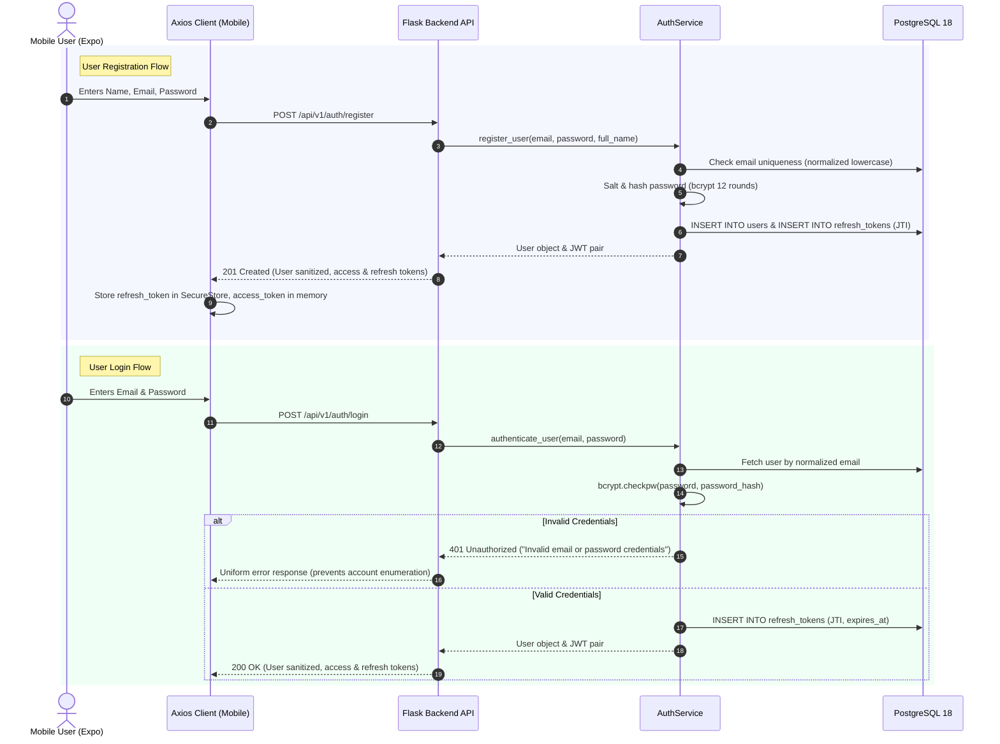

# LifeOS – Authentication Architecture

## 1. Overview
The LifeOS Authentication Architecture provides a zero-compromise, cryptographically secure foundation built on **Flask-JWT-Extended**, **salted bcrypt hashing** (work factor 12), and **persistent Refresh Token Rotation (RTR)** stored in **PostgreSQL 18**.

## 2. Authentication Flow Diagram



## 3. Account Enumeration Defense
- Failed authentication attempts return an identical error message: `"Invalid email or password credentials"`.
- Error codes and HTTP statuses (`401 Unauthorized`) do not vary whether the email is unallocated or the password was incorrect.
- Rate limiting enforces a strict quota (`15 requests / minute` for login, `10 requests / minute` for registration).

## 4. Sensitive Data Sanitization
- Database entity `User.to_dict()` exclusively serializes public identity fields:
  ```json
  {
    "id": "uuid-v4",
    "email": "user@lifeos.io",
    "full_name": "Alex Mercer",
    "avatar_url": null,
    "is_active": true,
    "created_at": "2026-11-07T12:00:00Z",
    "updated_at": "2026-11-07T12:00:00Z"
  }
  ```
- `password_hash` is strictly excluded from all schemas and responses.

