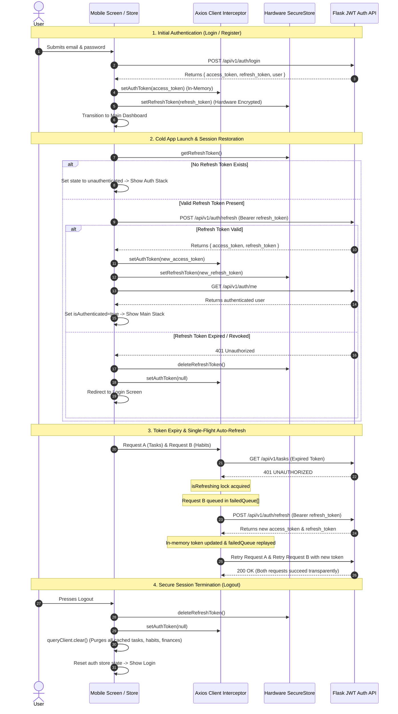

# LifeOS – Authentication & Session Lifecycle Architecture

This document details the complete client-server authentication flow, session restoration lifecycle, token rotation mechanics, single-flight concurrent request deduplication, and cache isolation standards implemented in LifeOS.

---

## 1. Authentication Architecture & Storage Security

LifeOS adheres to strict mobile security best practices to protect user sessions while preventing persistent token theft:

| Storage Tier | Target Token / Data | Implementation | Security Properties |
|---|---|---|---|
| **In-Memory Storage** | Short-Lived Access Token (15m expiry) | `mobile/src/api/client.ts` (`authToken` variable) | Never written to disk or device file system. Immune to unencrypted device backup attacks or extraction from physical storage. |
| **Encrypted Persistent Storage** | Long-Lived Refresh Token (30d expiry) | `expo-secure-store` (Keychain on iOS, Keystore/AES-GCM on Android) | Encrypted hardware-backed storage with cryptographic isolation. |
| **Persistent User Metadata** | User Profile, Onboarding Completed Flag | `zustand/middleware` (`persist`) | Non-sensitive UI preferences and flags stored in client storage. |
| **Server State Cache** | Private User Domain Entities | `queryClient` (TanStack Query) | Completely purged in-memory via `queryClient.clear()` on session termination. |

---

## 2. Authentication Lifecycle Diagram

---

## 3. Key Reliability & Security Mechanisms

### 3.1 Single-Flight Refresh Queue (`mobile/src/api/client.ts`)
When multiple concurrent queries fire (such as when the user opens the Dashboard which concurrently fetches Tasks, Habits, Goals, and Analytics), an expired access token causes multiple simultaneous 401 errors.

The LifeOS HTTP client handles this with an atomic single-flight lock:
1. `isRefreshing` flag: Set to `true` on the very first 401.
2. `failedQueue`: Array of pending promises representing each concurrent failed request.
3. Once the single refresh request resolves:
   - The in-memory access token is updated.
   - All queued requests are resolved and re-dispatched with the new token.
   - `isRefreshing` is reset to `false`.
4. If the refresh fails:
   - All queued requests are rejected.
   - `useAuthStore.getState().logout()` is triggered automatically.

### 3.2 Complete Query Cache Purge on Signout
To prevent cross-account privacy leakage (e.g. if User A logs out and User B logs in on the same shared device):
- `useAuthStore.ts` explicitly imports the centralized `queryClient` from `mobile/src/api/queryClient.ts`.
- In both `logout()` and `restoreSession()` failure branches, `queryClient.clear()` is executed immediately.
- This ensures zero stale financial records, private tasks, or health memories remain in RAM.

