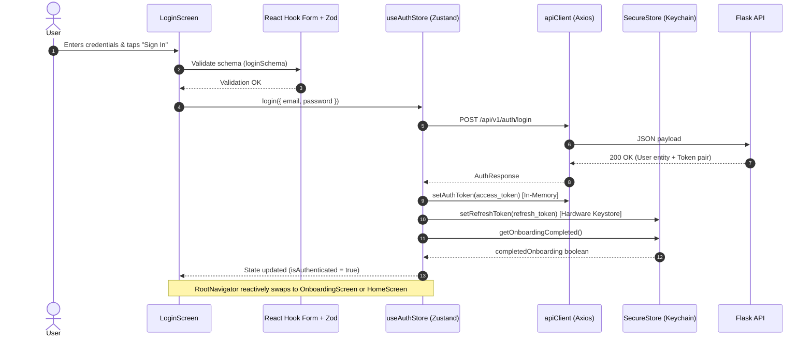

# LifeOS Auth UI Architecture

## 1. Overview & Principles

The LifeOS Authentication UI module implements an enterprise-grade mobile authentication and session lifecycle architecture adhering strictly to **White Glassmorphism** design standards, Zero Trust credential separation, and clean component isolation.

### Core Architectural Decisions
- **Separation of Concerns**: UI forms have no direct knowledge of API networking or persistent storage. They interact strictly through `useAuthStore` (Zustand) and typed schema validation (Zod + React Hook Form).
- **Zero Token Leakage**: Access tokens remain strictly in-memory (`authToken` in `api/client.ts`). Refresh tokens are persisted exclusively via hardware-backed `Expo SecureStore` (iOS Keychain / Android Keystore) or non-persistent session storage in web preview mode. `AsyncStorage` is forbidden for auth secrets.
- **Single-Flight Refresh Queue**: Prevents concurrent 401 refresh storms by queueing pending API calls while a single refresh request rotates the active JWT pair.
- **Reactive Navigation**: `RootNavigator` observes authentication and onboarding status from the store, rendering the appropriate screen stack without imperatively navigating or maintaining vulnerable routing history.

---

## 2. Component Hierarchy

```
App.tsx
├── QueryClientProvider (TanStack Query)
└── ThemeProvider (Light / Dark Glassmorphism)
    └── RootNavigator
        ├── SplashScreen (When isRestoringSession = true)
        ├── AuthNavigator (When !isAuthenticated)
        │   ├── WelcomeScreen (Hero branding, value props, navigation CTA)
        │   ├── LoginScreen (Email/password, show/hide, forgot dialog, submit)
        │   └── RegisterScreen (Name, email, password strength, confirmation)
        ├── OnboardingScreen (When isAuthenticated && !hasCompletedOnboarding)
        │   ├── Step 1: Welcome & Mission
        │   ├── Step 2: Core Focus Areas (Health, Career, Finance, Knowledge...)
        │   ├── Step 3: Initial Goals Selection
        │   ├── Step 4: Notification Cadence & AI Interaction Style
        │   └── Step 5: Summary & "Enter LifeOS"
        └── HomeScreen (When isAuthenticated && hasCompletedOnboarding)
            ├── Profile Summary Card (Name, email, active status badge)
            ├── Security Credentials & Token Storage Diagnostics Card
            ├── Configured Onboarding Preferences Card
            └── Sign Out Button (With ConfirmationModal)
```

---

## 3. State Management & Data Flow



---

## 4. Design System Compliance

All screens utilize the **Premium White Glassmorphism** design system tokens established in STEP 05:
- **Surface**: `#FFFFFF` with 75% opacity and subtle backdrop blur.
- **Background**: `#F7F8FC` (light mode), `#0F0F18` (dark mode).
- **Primary Color**: `#6C63FF` with linear gradient transitions to `#554CE0`.
- **Borders**: `#E9EAF2` with 1.5px subtle stroke width.
- **Shadows**: Multi-tier elevation (`subtle`, `floating`, `modal`).
- **Typography**: Inter/System typography with semantic scale (`Heading`, `BodyText`, `Caption`, `Label`).

