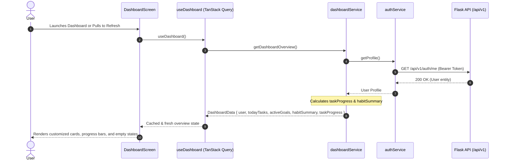

# LifeOS Home Dashboard Architecture

## 1. Overview & Architectural Role

The **LifeOS Home Dashboard** is the central command center of the AI Personal Operating System. It provides an immediate, unified high-level snapshot across all personal productivity domains:
- Today's prioritized tasks and completion progress
- Active personal/professional goals and milestone percentages
- Habits consistency and streak tracker
- Quick action launchers for day planning and task capture
- Proactive AI Assistant entry point

Adhering strictly to **White Glassmorphism** principles, the dashboard combines visual clarity, responsive performance, zero-friction pull-to-refresh, and accessible component hierarchies.

---

## 2. Component Hierarchy

```
MainTabNavigator (Bottom Tab Bar)
└── DashboardScreen (Active Tab: "HomeTab")
    ├── SafeAreaContainer (edges: ['top'])
    └── ScrollContainer (with RefreshControl)
        ├── DashboardHeader
        │   ├── Local Time Greeting ("Good Morning", "Good Afternoon", "Good Evening")
        │   ├── User First Name from Auth Profile
        │   ├── Formatted Current Date ("Tuesday, Nov 7")
        │   ├── Theme Toggle (Light / Dark Glass)
        │   ├── Notifications Action (with unread badge support)
        │   └── Profile Avatar Action (navigates to ProfileTab)
        ├── DailyOverviewCard
        │   ├── Progress percentage pill
        │   ├── Completed vs Total counter ("X of Y tasks completed")
        │   ├── Linear gradient progress bar
        │   └── Dynamic motivational message
        ├── QuickActionsSection
        │   ├── Add Task ──► TasksTab
        │   ├── Plan Day ──► PlannerTab
        │   ├── Create Goal ──► GoalsTab
        │   └── Talk to AI ──► AI Assistant Modal
        ├── TodayTasksSection
        │   ├── SectionHeader ("Today's Tasks" + "View All")
        │   ├── SkeletonLoader (when isLoading)
        │   ├── ErrorState (when isError with retry)
        │   ├── EmptyState (when tasks.length === 0)
        │   └── Task Item Cards (title, priority badge, due time)
        ├── ActiveGoalsSection
        │   ├── SectionHeader ("Active Goals" + "View All")
        │   ├── SkeletonLoader
        │   ├── EmptyState (when goals.length === 0)
        │   └── Goal Progress Cards (title, target date, progress bar)
        ├── HabitSummarySection
        │   ├── SectionHeader ("Habits & Streaks" + "View All")
        │   └── Habits Metric Card (Active count, Done Today count, Consistency %)
        └── AIQuickAccessCard
            ├── Local AI Assistant Badge
            ├── Intelligent orchestration description
            └── "Talk to LifeOS" Action Button
```

---

## 3. Data Flow & Reactivity



---

## 4. Performance Optimizations

1. **Selective Glass Effects**: Blur overlays are restricted to the static `GlassBottomNavigation` bar on iOS. Scrolling list items use opaque glass fallbacks (`theme.colors.glassBackgroundSolid`) with subtle borders to guarantee 60fps scrolling on mid-range mobile devices.
2. **Zero Nested ScrollViews**: `ScrollContainer` manages the single outer vertical scroll view. Inner sections use flat mapped arrays without nested vertical scroll containers.
3. **Query Stale-Time Caching**: TanStack Query caches dashboard data with `staleTime: 2 minutes`, preventing duplicate API calls when users switch tabs and return to Home.

