# LifeOS – Complete Database ER Diagram

## 1. Overview
The LifeOS database is designed with full relational normalization (3NF), 36-character UUID primary keys, UTC timezone-aware timestamps, foreign keys with explicit cascading semantics, unique business keys, and performance indexing.

## 2. Complete Entity-Relationship Diagram

```mermaid
erDiagram
    USERS ||--o| USER_PREFERENCES : configures
    USERS ||--o{ REFRESH_TOKENS : issues
    USERS ||--o{ TASK_CATEGORIES : organizes
    USERS ||--o{ TASKS : owns
    USERS ||--o{ GOALS : pursues
    USERS ||--o{ HABITS : builds
    USERS ||--o{ PLANNER_BLOCKS : schedules
    USERS ||--o{ NOTES : captures
    USERS ||--o{ NOTE_TAGS : categorizes
    USERS ||--o{ AI_CONVERSATIONS : chats
    USERS ||--o{ AI_MEMORIES : retains
    USERS ||--o{ FINANCIAL_ACCOUNTS : holds
    USERS ||--o{ FINANCIAL_CATEGORIES : budgets
    USERS ||--o{ FINANCIAL_TRANSACTIONS : records
    USERS ||--o{ NOTIFICATIONS : receives
    USERS ||--o{ ACTIVITY_LOGS : audits

    TASKS }o--o| TASK_CATEGORIES : classifies
    TASKS ||--o{ PLANNER_BLOCKS : assigns
    GOALS ||--o{ GOAL_MILESTONES : tracks
    HABITS ||--o{ HABIT_LOGS : records
    NOTES }o--o{ NOTE_TAG_ASSOCIATION : tags
    NOTE_TAGS }o--o{ NOTE_TAG_ASSOCIATION : tagged_in
    AI_CONVERSATIONS ||--o{ AI_MESSAGES : contains
    FINANCIAL_TRANSACTIONS }o--|| FINANCIAL_ACCOUNTS : debits_credits
    FINANCIAL_TRANSACTIONS }o--o| FINANCIAL_CATEGORIES : classifies

    USERS {
        varchar_36 id PK
        varchar_255 email UK
        varchar_255 password_hash
        varchar_100 full_name
        varchar_500 avatar_url
        boolean is_active
        timestamptz created_at
        timestamptz updated_at
    }

    USER_PREFERENCES {
        varchar_36 id PK
        varchar_36 user_id FK,UK
        varchar_20 theme
        varchar_50 timezone
        boolean notifications_enabled
        boolean ai_daily_summary
        varchar_30 ai_tone
        varchar_10 currency
        timestamptz created_at
        timestamptz updated_at
    }

    REFRESH_TOKENS {
        varchar_36 id PK
        varchar_36 user_id FK
        varchar_36 token_jti UK
        varchar_255 token_hash
        timestamptz expires_at
        boolean is_revoked
        timestamptz created_at
    }

    TASK_CATEGORIES {
        varchar_36 id PK
        varchar_36 user_id FK
        varchar_100 name
        varchar_10 color_hex
        varchar_50 icon
        timestamptz created_at
    }

    TASKS {
        varchar_36 id PK
        varchar_36 user_id FK
        varchar_36 category_id FK
        varchar_255 title
        text description
        varchar_20 status
        varchar_20 priority
        timestamptz due_date
        timestamptz completed_at
        boolean is_archived
        integer estimated_minutes
        timestamptz created_at
        timestamptz updated_at
    }

    GOALS {
        varchar_36 id PK
        varchar_36 user_id FK
        varchar_255 title
        text description
        timestamptz target_date
        varchar_20 status
        float progress_percent
        varchar_50 category
        timestamptz created_at
        timestamptz updated_at
    }

    GOAL_MILESTONES {
        varchar_36 id PK
        varchar_36 goal_id FK
        varchar_255 title
        timestamptz target_date
        boolean is_completed
        timestamptz completed_at
        integer sort_order
        timestamptz created_at
    }

    HABITS {
        varchar_36 id PK
        varchar_36 user_id FK
        varchar_255 title
        text description
        varchar_20 frequency
        integer target_days_per_week
        integer current_streak
        integer longest_streak
        varchar_10 color_hex
        varchar_50 icon
        boolean is_archived
        timestamptz created_at
        timestamptz updated_at
    }

    HABIT_LOGS {
        varchar_36 id PK
        varchar_36 habit_id FK
        date log_date
        boolean completed
        text notes
        timestamptz created_at
    }

    PLANNER_BLOCKS {
        varchar_36 id PK
        varchar_36 user_id FK
        varchar_36 task_id FK
        varchar_255 title
        timestamptz start_time
        timestamptz end_time
        varchar_30 block_type
        boolean is_completed
        timestamptz created_at
        timestamptz updated_at
    }

    NOTES {
        varchar_36 id PK
        varchar_36 user_id FK
        varchar_255 title
        text content
        boolean is_pinned
        boolean is_archived
        timestamptz created_at
        timestamptz updated_at
    }

    NOTE_TAGS {
        varchar_36 id PK
        varchar_36 user_id FK
        varchar_50 name
        varchar_10 color_hex
        timestamptz created_at
    }

    NOTE_TAG_ASSOCIATION {
        varchar_36 note_id FK,PK
        varchar_36 tag_id FK,PK
    }

    AI_CONVERSATIONS {
        varchar_36 id PK
        varchar_36 user_id FK
        varchar_255 title
        varchar_50 model_used
        timestamptz created_at
        timestamptz updated_at
    }

    AI_MESSAGES {
        varchar_36 id PK
        varchar_36 conversation_id FK
        varchar_20 role
        text content
        json tool_calls
        integer tokens_used
        timestamptz created_at
    }

    AI_MEMORIES {
        varchar_36 id PK
        varchar_36 user_id FK
        varchar_100 memory_key
        text memory_value
        varchar_30 memory_type
        float confidence
        json embedding
        timestamptz last_accessed_at
        timestamptz created_at
        timestamptz updated_at
    }

    FINANCIAL_ACCOUNTS {
        varchar_36 id PK
        varchar_36 user_id FK
        varchar_100 name
        varchar_30 account_type
        numeric_14_2 balance
        varchar_10 currency
        boolean is_active
        timestamptz created_at
        timestamptz updated_at
    }

    FINANCIAL_CATEGORIES {
        varchar_36 id PK
        varchar_36 user_id FK
        varchar_100 name
        varchar_20 category_type
        varchar_50 icon
        varchar_10 color_hex
        numeric_14_2 monthly_budget
        timestamptz created_at
    }

    FINANCIAL_TRANSACTIONS {
        varchar_36 id PK
        varchar_36 user_id FK
        varchar_36 account_id FK
        varchar_36 category_id FK
        numeric_14_2 amount
        varchar_20 transaction_type
        varchar_255 description
        timestamptz transaction_date
        boolean is_recurring
        timestamptz created_at
        timestamptz updated_at
    }

    NOTIFICATIONS {
        varchar_36 id PK
        varchar_36 user_id FK
        varchar_255 title
        text body
        varchar_30 notification_type
        varchar_30 entity_type
        varchar_36 entity_id
        boolean is_read
        timestamptz read_at
        timestamptz scheduled_for
        timestamptz created_at
    }

    ACTIVITY_LOGS {
        varchar_36 id PK
        varchar_36 user_id FK
        varchar_50 action
        varchar_50 entity_type
        varchar_36 entity_id
        json details
        varchar_45 ip_address
        timestamptz created_at
    }
```

