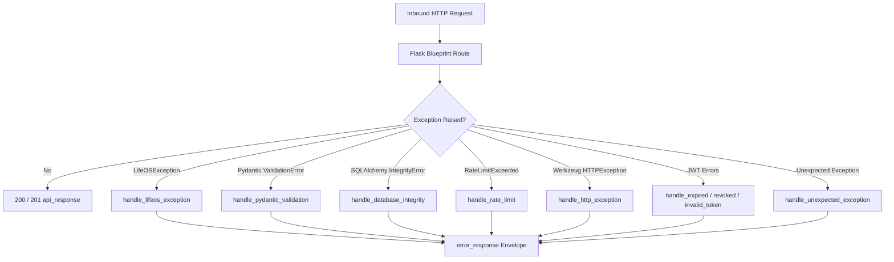

# LifeOS – Centralized Error Handling

## 1. Design Philosophy
Clients must receive structured, predictable error envelopes with semantic machine-readable error codes. Internal tracebacks, database dialect details, and infrastructure credentials must **never** be exposed in client responses.

## 2. Global Exception Interceptor Architecture
The centralized error handling mechanism is initialized via `register_error_handlers(app)` in `app/core/handlers.py`:

## 3. Custom Domain Exception Hierarchy
- `LifeOSException`: Base class with `status_code`, `error_code`, `message`, `payload`.
  - `NotFoundException` (404, `NOT_FOUND`)
  - `ValidationException` (422, `VALIDATION_ERROR`)
  - `UnauthorizedException` (401, `AUTHENTICATION_ERROR`)
  - `ForbiddenException` (403, `AUTHORIZATION_ERROR`)
  - `ConflictException` (409, `CONFLICT`)
  - `IntegrityException` (409, `INTEGRITY_ERROR`)
  - `RateLimitException` (429, `RATE_LIMIT_EXCEEDED`)

