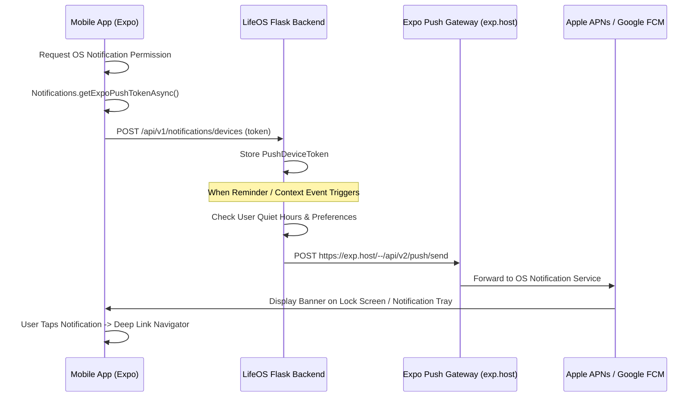

# LifeOS Expo Push Notifications Configuration Guide

## 1. Overview

LifeOS uses Expo's push notification architecture. Push notification delivery is strictly optional:
- If a user grants push notification permissions, the app registers their `ExponentPushToken` with the LifeOS backend.
- If a user denies permissions, or if running in web/simulator environments where APNs/FCM tokens are unavailable, LifeOS degrades gracefully—in-app notifications and bell badges continue functioning without error.

## 2. Push Delivery Flow



## 3. Client Setup in React Native Expo

1. **Permission Request**:
   Implemented in [`mobile/src/services/pushNotificationService.ts`](file:///C:/Users/NexviTech/Desktop/LifePs/mobile/src/services/pushNotificationService.ts).
   When the user toggles "Expo Push Notifications" in `NotificationSettingsScreen`:
   ```typescript
   const res = await pushNotificationService.registerForPushNotifications();
   ```

2. **Safe Runtime Fallback**:
   To prevent build failures or runtime crashes on Node.js/web/virtual simulators:
   ```typescript
   if (Platform.OS === 'web') return { status: 'unsupported' };
   if (!Device.isDevice) return { status: 'unsupported' };
   ```

3. **Deep Linking Payload Format**:
   Notifications include a `data_payload` JSON dictionary:
   ```json
   {
     "route": "TasksTab",
     "taskId": "task-uuid-123"
   }
   ```
   When the user taps the notification, [`parseNotificationDeepLink()`](file:///C:/Users/NexviTech/Desktop/LifePs/mobile/src/services/pushNotificationService.ts#L65) extracts the route and navigates directly to the target feature.

