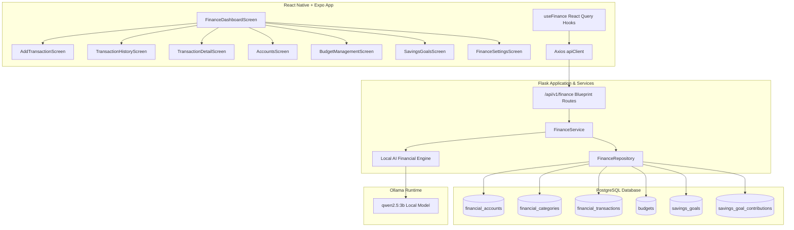

# LifeOS Personal Money Management Architecture

## 1. Architectural Overview

The LifeOS Personal Money Management Module (Step 14) delivers a personal budgeting, balance tracking, and savings management system built on strict privacy, local-first computing, and exact decimal arithmetic.

## 2. Design Principles & Hard Constraints

1. **Exact Decimal Precision**: All balance calculations, transaction additions/reversals, budget utilization rates, and savings contributions use Python `Decimal` (`NUMERIC(14, 2)`) and are quantized to `0.01`. Floating-point binary approximation errors (e.g. `0.1 + 0.2 = 0.30000000000000004`) are eliminated.
2. **Deterministic Double-Check Architecture**: Balance state is transaction-driven. Any mutation (create, edit, soft-delete) updates the parent account's balance atomically within the same database transaction.
3. **No External Cloud AI or Paid APIs**: No OpenAI API calls. Financial summary generation and insight narrative observation utilize the local Ollama `qwen2.5:3b` engine. If Ollama is offline, a deterministic rules-based fallback produces mathematically verified insights.
4. **No Third-Party Banking Integrations**: No Plaid, Yodlee, bank feeds, payment gateways, or crypto trading integrations. All data is user-managed and private.
5. **Strict IDOR Authorization**: Every route validates user ownership of accounts, categories, transactions, budgets, and savings goals using the authenticated JWT `sub` identity. Cross-user operations return HTTP 404 or 403.

## 3. Core Subsystems

### A. Account & Balance Management
- Accounts support multiple types: `bank`, `cash`, `credit`, `savings`, `investment`, `other`.
- Only one account can be marked `is_default: true` at a time. Designating an account as default automatically unsets the flag on any previously default account.
- When a transaction is recorded:
  - `income`: increases account balance (`balance += amount`).
  - `expense`: decreases account balance (`balance -= amount`).
  - `transfer`: shifts balance between source and destination accounts.
- Updating or soft-deleting a transaction reverses previous balance deltas and applies the new delta.

### B. Category Organization & Seeding
- Users are initialized with 15 standard system categories (`DEFAULT_SYSTEM_CATEGORIES`) for essential income and expenses.
- System categories are protected against accidental deletion (`is_system: true`).
- Custom user categories cannot be deleted if active transactions are assigned to them (protected via integrity checks).

### C. Monthly Budget Utilization
- Budgets can be assigned to a specific category or represent an overall monthly spending ceiling (`category_id = null`).
- Utilization is computed dynamically:
  $$\text{Spent} = \sum \text{expense transactions for month and category}$$
  $$\text{Utilization \%} = \min\left(100.0, \frac{\text{Spent}}{\text{Budget}} \times 100\right)$$
  $$\text{Over Budget} = \text{Spent} > \text{Budget}$$

### D. Savings Goals & Contribution Ledger
- Savings goals maintain target amounts, target dates, and real-time accumulated balances.
- Each fund deposit creates a `SavingsGoalContribution` audit record and increments the goal's `current_amount`.
- When `current_amount >= target_amount`, the goal status is set to `completed`.

### E. Local AI Financial Insights
- The backend compiles verified financial facts (total balance, monthly income, expenses, net savings, top category, budget overruns).
- Prompt template instructs the local LLM to deliver a 2-3 sentence strategic observation focusing on savings rate, over-budget categories, and recommendations without hallucinatory data.

