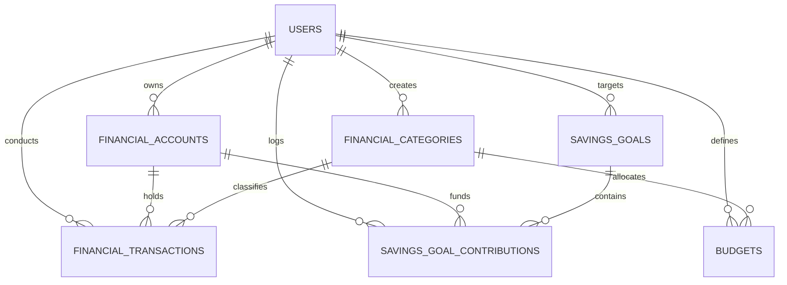

# LifeOS Personal Finance Database Schema Reference

## 1. Relational Entity Overview

The financial domain consists of 6 tables with foreign-key cascade protections, decimal numeric quantization, and indexing on frequent query filters (`user_id`, `transaction_date`, `month`, `is_deleted`).

## 2. Table Specifications

### `financial_accounts`
| Column | Type | Constraints | Description |
|---|---|---|---|
| `id` | VARCHAR(36) | PRIMARY KEY | UUID |
| `user_id` | VARCHAR(36) | FOREIGN KEY (users.id, CASCADE) | Account owner |
| `name` | VARCHAR(100) | NOT NULL | Account name |
| `account_type` | VARCHAR(20) | NOT NULL | `bank`, `cash`, `credit`, `savings`, `investment`, `other` |
| `balance` | NUMERIC(14,2) | NOT NULL, DEFAULT 0.00 | Exact balance |
| `currency` | VARCHAR(10) | NOT NULL, DEFAULT 'USD' | ISO 4217 currency code |
| `is_active` | BOOLEAN | NOT NULL, DEFAULT TRUE | Active flag |
| `is_archived` | BOOLEAN | NOT NULL, DEFAULT FALSE | Archived flag |
| `is_default` | BOOLEAN | NOT NULL, DEFAULT FALSE | Default account flag |
| `color_hex` | VARCHAR(10) | NOT NULL, DEFAULT '#6C63FF' | Hex color tag |
| `icon` | VARCHAR(50) | NOT NULL, DEFAULT 'wallet' | Icon identifier |
| `created_at` | TIMESTAMPTZ | NOT NULL | Creation timestamp |
| `updated_at` | TIMESTAMPTZ | NOT NULL | Last modified timestamp |

### `financial_categories`
| Column | Type | Constraints | Description |
|---|---|---|---|
| `id` | VARCHAR(36) | PRIMARY KEY | UUID |
| `user_id` | VARCHAR(36) | FOREIGN KEY (users.id, CASCADE), NULLABLE | Owner (NULL for shared system defaults) |
| `name` | VARCHAR(100) | NOT NULL | Category title |
| `category_type` | VARCHAR(20) | NOT NULL | `income`, `expense`, `transfer` |
| `color_hex` | VARCHAR(10) | NOT NULL, DEFAULT '#6C63FF' | Color indicator |
| `icon` | VARCHAR(50) | NOT NULL, DEFAULT 'pricetag' | Icon name |
| `is_system` | BOOLEAN | NOT NULL, DEFAULT FALSE | Protected system category flag |
| `created_at` | TIMESTAMPTZ | NOT NULL | Creation timestamp |

### `financial_transactions`
| Column | Type | Constraints | Description |
|---|---|---|---|
| `id` | VARCHAR(36) | PRIMARY KEY | UUID |
| `user_id` | VARCHAR(36) | FOREIGN KEY (users.id, CASCADE) | Owner |
| `account_id` | VARCHAR(36) | FOREIGN KEY (financial_accounts.id, CASCADE) | Source account |
| `category_id` | VARCHAR(36) | FOREIGN KEY (financial_categories.id, SET NULL), NULLABLE | Classification |
| `amount` | NUMERIC(14,2) | NOT NULL | Strictly positive transaction magnitude |
| `transaction_type` | VARCHAR(20) | NOT NULL | `income`, `expense`, `transfer` |
| `description` | VARCHAR(255) | NOT NULL | Memo / narrative description |
| `transaction_date` | TIMESTAMPTZ | NOT NULL, INDEXED | Effective date of transaction |
| `is_recurring` | BOOLEAN | NOT NULL, DEFAULT FALSE | Recurring indicator |
| `is_deleted` | BOOLEAN | NOT NULL, DEFAULT FALSE, INDEXED | Soft-delete flag |
| `deleted_at` | TIMESTAMPTZ | NULLABLE | Deletion timestamp |
| `created_at` | TIMESTAMPTZ | NOT NULL | Record creation timestamp |
| `updated_at` | TIMESTAMPTZ | NOT NULL | Record modification timestamp |

### `budgets`
| Column | Type | Constraints | Description |
|---|---|---|---|
| `id` | VARCHAR(36) | PRIMARY KEY | UUID |
| `user_id` | VARCHAR(36) | FOREIGN KEY (users.id, CASCADE) | Owner |
| `category_id` | VARCHAR(36) | FOREIGN KEY (financial_categories.id, CASCADE), NULLABLE | Category (NULL = overall monthly budget) |
| `month` | VARCHAR(7) | NOT NULL, INDEXED | Target month (`YYYY-MM`) |
| `amount` | NUMERIC(14,2) | NOT NULL | Spending limit |
| `currency` | VARCHAR(10) | NOT NULL, DEFAULT 'USD' | Currency |
| `created_at` | TIMESTAMPTZ | NOT NULL | Created timestamp |
| `updated_at` | TIMESTAMPTZ | NOT NULL | Modified timestamp |

**Unique Constraint**: `uq_budget_user_category_month` on `(user_id, category_id, month)`.

### `savings_goals`
| Column | Type | Constraints | Description |
|---|---|---|---|
| `id` | VARCHAR(36) | PRIMARY KEY | UUID |
| `user_id` | VARCHAR(36) | FOREIGN KEY (users.id, CASCADE) | Owner |
| `title` | VARCHAR(150) | NOT NULL | Target purpose |
| `target_amount` | NUMERIC(14,2) | NOT NULL | Goal threshold |
| `current_amount` | NUMERIC(14,2) | NOT NULL, DEFAULT 0.00 | Accumulated savings |
| `target_date` | TIMESTAMPTZ | NULLABLE | Milestone deadline |
| `status` | VARCHAR(20) | NOT NULL, DEFAULT 'in_progress' | `in_progress`, `completed`, `archived` |
| `currency` | VARCHAR(10) | NOT NULL, DEFAULT 'USD' | Currency |
| `color_hex` | VARCHAR(10) | NOT NULL, DEFAULT '#6C63FF' | Color indicator |
| `icon` | VARCHAR(50) | NOT NULL, DEFAULT 'flag' | Icon |
| `notes` | TEXT | NULLABLE | Description and plan |
| `created_at` | TIMESTAMPTZ | NOT NULL | Creation timestamp |
| `updated_at` | TIMESTAMPTZ | NOT NULL | Last modified timestamp |

### `savings_goal_contributions`
| Column | Type | Constraints | Description |
|---|---|---|---|
| `id` | VARCHAR(36) | PRIMARY KEY | UUID |
| `savings_goal_id` | VARCHAR(36) | FOREIGN KEY (savings_goals.id, CASCADE) | Target goal |
| `user_id` | VARCHAR(36) | FOREIGN KEY (users.id, CASCADE) | Owner |
| `account_id` | VARCHAR(36) | FOREIGN KEY (financial_accounts.id, SET NULL), NULLABLE | Originating account |
| `amount` | NUMERIC(14,2) | NOT NULL | Contribution amount |
| `contribution_date` | TIMESTAMPTZ | NOT NULL, DEFAULT now() | Date of deposit |
| `note` | VARCHAR(255) | NULLABLE | Memo |
| `created_at` | TIMESTAMPTZ | NOT NULL | Timestamp |

## 3. Migration History
- **Revision `24a8f1665cef`**: `add_step14_finance_tables_and_columns` (Child of `ee971e5ed97a`).
  - Added columns `is_archived`, `is_default`, `color_hex`, `icon` to `financial_accounts`.
  - Added column `is_system` to `financial_categories`.
  - Added columns `is_deleted`, `deleted_at` to `financial_transactions`.
  - Created tables `budgets`, `savings_goals`, and `savings_goal_contributions`.
  - Applied to PostgreSQL database without breaking existing data.

