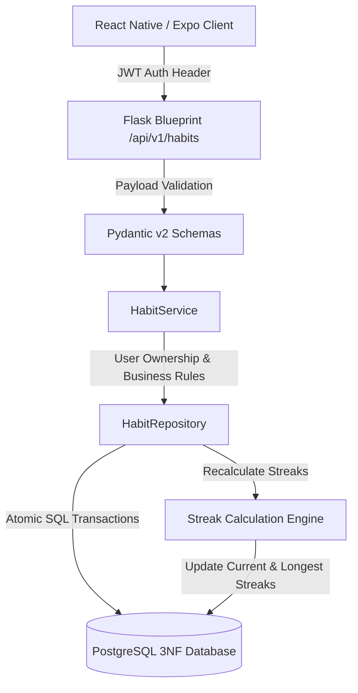

# LifeOS Habit Tracking & Streak Engine Architecture

## 1. Domain Overview
The Habit Tracking module in LifeOS provides an end-to-end subsystem for users to build, monitor, and sustain recurring positive routines. Habits are tied to authenticated user accounts, supporting daily routines, weekday-only workflows, and weekly completion targets.

## 2. Core Architectural Principles
1. **Server-Side Truth**: All streak calculations (`current_streak`, `longest_streak`, `completion_rate`, `consistency`) are computed server-side. Client apps cannot fabricate or spoof streak lengths.
2. **Strict Resource Isolation (IDOR Protection)**: Every operation strictly enforces `check_resource_ownership(habit.user_id, current_user_id)`.
3. **Idempotent Check-Ins**: The database enforces a unique constraint `uq_habit_log_date (habit_id, log_date)`. Multiple check-in attempts on the same calendar day update the existing record rather than creating duplicate logs.
4. **Resilient Streaks**: For daily habits, an incomplete habit on the current calendar day does not break an ongoing streak until the day elapses. For weekday-only habits, weekends do not break streaks.
5. **Optimistic UI with Rollback**: React Native components utilize TanStack Query mutations to update check-in toggles optimistically while reverting gracefully on network errors.

## 3. Module Structure
- **Backend Model**: `app.models.habit.Habit`, `app.models.habit.HabitLog`
- **Backend Schemas**: `app.schemas.habit.CreateHabitRequest`, `UpdateHabitRequest`, `CreateHabitLogRequest`
- **Backend Repository**: `app.repositories.habit_repository.HabitRepository`
- **Backend Service**: `app.services.habit_service.HabitService`
- **Backend Routes**: `app.blueprints.habits.routes` registered at `/api/v1/habits`
- **Mobile Types**: `mobile/src/types/habit.ts`
- **Mobile Schemas**: `mobile/src/schemas/habit.ts`
- **Mobile Service**: `mobile/src/services/habitService.ts`
- **Mobile State/Hooks**: `mobile/src/hooks/useHabits.ts`
- **Mobile UI**: `HabitsScreen.tsx`, `CreateEditHabitModal.tsx`, `HabitDetailsModal.tsx`

