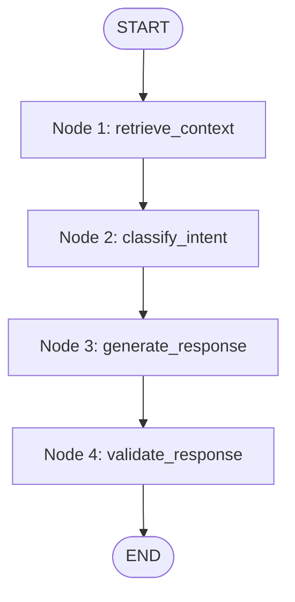

# LifeOS LangGraph Agentic Workflow

## 1. Workflow Architecture
The LifeOS Agent uses LangGraph 1.2 to coordinate context loading, user intent classification, local prompt generation, and output verification.



---

## 2. Typed State Definition

```python
class LifeOSAgentState(TypedDict):
    user_id: str                      # Authenticated user ID
    user_message: str                 # Raw user prompt
    conversation_id: str              # Active thread UUID
    history: List[BaseMessage]        # Up to 8 previous turns
    context_data: Dict[str, Any]      # Structured database snapshot
    formatted_context: str            # Clean markdown context block
    intent: str                       # e.g., 'tasks_inquiry', 'schedule_inquiry'
    response: str                     # Assistant final markdown response
    error: Optional[str]              # Runtime diagnostics
```

---

## 3. Node Specifications

### Node 1: `retrieve_context`
- Queries user's tasks, active goals, habits, and today's schedule from the database.
- Bounded to 4–6 items per category to avoid context bloating.
- Prepares a formatted markdown context string.

### Node 2: `classify_intent`
- Inspects user input tokens for domain markers:
  - `task`, `todo`, `priority` $\rightarrow$ `tasks_inquiry`
  - `habit`, `streak` $\rightarrow$ `habits_inquiry`
  - `goal`, `milestone` $\rightarrow$ `goals_inquiry`
  - `planner`, `schedule`, `time` $\rightarrow$ `schedule_inquiry`
  - `overview`, `summary`, `morning` $\rightarrow$ `daily_overview`

### Node 3: `generate_response`
- Compiles the system message injecting the structured `formatted_context`.
- Appends conversation history for multi-turn dialogue continuity.
- Invokes `ChatOllama(model="qwen2.5:3b")`.
- Implements fallback error handling if Ollama is unreachable.

### Node 4: `validate_response`
- Verifies non-empty output string.
- Strips any accidental system prompt echoes.
- Ensures clean markdown rendering for React Native mobile display.

