# LIFEOS — COMPLETE AI FEATURE AUDIT & SAFE REMOVAL PLAN

**Status**: READ-ONLY AUDIT & STRATEGIC RECOMMENDATION  
**Date**: November 9, 2026  
**Auditor**: Antigravity Local Engineering Assistant  
**Repository Branch**: `main`  
**Application State**: 100% Intact, Unmodified, Non-Destructive Audit  

---

## EXECUTIVE SUMMARY

LifeOS was architected modularly with clear service boundaries. The non-AI modules—**Authentication, Tasks, Goals, Habits, Planner, Finance, Notifications, Automations, Analytics, and Personalization**—are driven by deterministic PostgreSQL queries and client-side logic. 

While AI inference (Ollama `qwen2.5:3b`, LangGraph agent graphs, AI Memory, Feedback Intelligence, Model Registry, and QLoRA pipeline) provides conversational assistance and learning capabilities, **the entire core productivity foundation can run completely independently of AI without breaking application startup, database transactions, or user data**.

This document details the exact inventory, categorization, dependency structure, impact matrix, and three strategic options for your decision.

---

## 1. COMPLETE AI FEATURE INVENTORY

The audit identified the following AI components across the codebase:

| Component | Codebase Locations | Description |
| :--- | :--- | :--- |
| **Ollama Runtime & Client** | `backend/app/ai/config.py`, `backend/app/config.py` | Connects via HTTP to local Ollama on port 11434 (`ChatOllama`). Checks health, loads `qwen2.5:3b`. |
| **Conversational Assistant & Streaming** | `backend/app/blueprints/ai/routes.py`, `backend/app/services/ai_service.py`, `backend/app/ai/workflow.py` | Multi-turn chat, intent routing, token streaming via SSE (`POST /api/v1/ai/chat/stream`), LangGraph graph. |
| **Personal Context Injection Engine** | `backend/app/ai/context_engine.py`, `backend/app/ai/tools.py` | Reads user tasks, schedule, goals, habits, and finance to format context text for LLM prompts. |
| **AI Memory ("Digital Brain")** | `backend/app/ai/memory/`, `backend/app/blueprints/ai_memory/routes.py`, `backend/app/services/ai_memory_service.py` | Dialogue extraction, duplicate/contradiction detection, user review/approval, and memory retrieval. |
| **Personal Intelligence & Insights** | `backend/app/services/personal_intelligence_service.py` | Rule-based and LLM-assisted schedule clash detection, habit streak alerts, and daily morning briefing. |
| **Feedback Intelligence & Learning Consent** | `backend/app/blueprints/ai_feedback/routes.py`, `backend/app/services/ai_feedback_service.py`, `backend/app/services/feedback_intelligence_service.py` | Thumbs-up/down ratings, user corrections, feedback analytics, and `ai_training_consent` opt-in/opt-out. |
| **AI Prompt Registry** | `backend/app/blueprints/ai_prompt/routes.py`, `backend/app/services/ai_prompt_service.py` | Versioned system prompts (`AIPromptVersion`), rollback, and activation tracking. |
| **Training Dataset Management (Step 7)** | `backend/app/blueprints/ai_dataset/routes.py`, `backend/app/services/ai_dataset_service.py`, `backend/app/ai/dataset/` | Curated sample creation, regex PII/secret sanitizer, validation gates, version snapshot hashing, JSONL export. |
| **Model Evaluation & Benchmarking (Step 9)** | `backend/app/services/model_evaluation_service.py`, `backend/app/ai/evaluation/` | Automated scoring across relevance, factual consistency, completeness, and latency against synthetic benchmark suites. |
| **Model Registry & Rollback (Step 10)** | `backend/app/blueprints/ai_model/routes.py`, `backend/app/services/model_registry_service.py` | Model version lifecycle (`registered`, `candidate`, `evaluated`, `approved`, `active`), atomic activation, audit logs. |
| **Continuous AI Improvement (Step 11)** | `backend/app/blueprints/ai_improvement/routes.py`, `backend/app/services/continuous_improvement_service.py` | Orchestrates feedback readiness thresholds, training job tracking (`AITrainingJob`), and safe verification loops. |
| **QLoRA Fine-Tuning Pipeline (Step 8)** | `training/`, `backend/app/ai/training/` | Standalone Python training scripts (`train_qlora.py`), Modelfile packaging generator, Google Colab notebook. |
| **AI Automations Planner** | `backend/app/ai/automation/workflow.py`, `backend/app/ai/automation/templates.py`, `backend/app/ai/automation/tools.py` | LangGraph agent for natural-language automation trigger execution. |
| **Voice Assistant LLM Turn** | `backend/app/services/voice/voice_service.py` | Text-to-speech / Speech-to-text pipeline integrating with LLM response generation. |
| **Mobile AI Screens** | `mobile/src/screens/ai/AIAssistantScreen.tsx`, `mobile/src/screens/ai/memory/AIMemoryScreen.tsx`, `mobile/src/screens/ai/AIImprovementDashboardScreen.tsx` | React Native chat interface with streaming markdown, memory review dashboard, and continuous improvement console. |

---

## 2. COMPONENT CLASSIFICATION

Every component has been categorized into one of four classes:
- **Category A — AI ONLY**: Exclusively serves AI functions. Can be removed or disabled without affecting any core user workflows.
- **Category B — CORE APPLICATION**: The foundation of LifeOS. Must remain permanently intact.
- **Category C — SHARED**: Bridges core models and AI features. Requires clean decoupling so core logic runs standalone.
- **Category D — OPTIONAL**: Core-adjacent features that can remain active or disabled via user preference toggles.

```mermaid
flowchart TD
    subgraph CoreApp["Category B: Core Application (Must Keep)"]
        AUTH["Authentication & JWT"]
        TASKS["Tasks & Projects"]
        GOALS["Goals & Milestones"]
        HABITS["Habits & Logs"]
        PLAN["Planner & Schedule"]
        FIN["Finance & Budgets"]
        NOTIF["Notifications & Reminders"]
        AUTO_CORE["Automation Service Core"]
        DASH["Dashboard & Widgets"]
        ANALYTICS_CORE["Deterministic Analytics Engine"]
    end

    subgraph Shared["Category C: Shared (Decouple Hooks)"]
        UPREF["UserPreference (Theme, Timezone, ai_memory_enabled, ai_training_consent)"]
        UPERS["UserPersonalization (Productivity Style, Routine, Preferred Name)"]
        FIN_INS["Finance Service (Deterministic summaries with optional LLM hook)"]
        AN_INS["Analytics Service (Deterministic scores with optional LLM narrative)"]
        VOICE_SVC["Voice Service (Audio transcription / playback vs LLM turn)"]
    end

    subgraph AIOnly["Category A: AI Only (Safely Removable/Disablable)"]
        OLLAMA["Ollama / LangChain / LangGraph Engine"]
        CHAT["AI Assistant & Chat Routes"]
        MEM["AI Memory & Digital Brain"]
        FEED["AI Feedback & Intelligence"]
        PROMPT["AI Prompt Versions"]
        DATASET["Dataset Curation & Sanitizer"]
        MODEL_REG["Model Registry & Rollback"]
        EVAL["Model Evaluation Runner"]
        TRAINING["QLoRA Training Scripts & Notebook"]
        MOBILE_AI["Mobile AI Screens & Nav Routes"]
    end

    CoreApp --> Shared
    Shared -.->|Optional Hook| AIOnly
```



### Detailed Component Classification Table

| Component | Category | Purpose & Decoupling Strategy |
| :--- | :---: | :--- |
| `app.models.user.User` | **B (CORE)** | Core authentication identity, bcrypt password hash, roles. **No AI dependency.** |
| `app.models.task.Task` | **B (CORE)** | CRUD tasks, priority, due dates, project association. **No AI dependency.** |
| `app.models.goal.Goal`, `Milestone` | **B (CORE)** | Progress tracking, targets, status. **No AI dependency.** |
| `app.models.habit.Habit`, `HabitLog` | **B (CORE)** | Streaks, frequency, completion logs. **No AI dependency.** |
| `app.models.planner.PlannerBlock` | **B (CORE)** | Time blocking, schedule overlaps, calendar. **No AI dependency.** |
| `app.models.finance.*` | **B (CORE)** | Accounts, transactions, budgets, cash flow. **No AI dependency.** |
| `app.models.notification.*` | **B (CORE)** | In-app alerts, push tokens, quiet hours, delivery logs. **No AI dependency.** |
| `app.models.automation.*` | **B (CORE)** | Automation definitions, executions, logs, approval gates. |
| `app.services.notification_service.py` | **B (CORE)** | Deterministic cron/scheduler alerts for tasks, habits, goals, meetings. |
| `app.models.ai.AIConversation` | **A (AI ONLY)** | Chat threads between user and local AI. Removable if AI removed. |
| `app.models.ai.AIMessage` | **A (AI ONLY)** | Message exchanges. Removable if AI removed. |
| `app.models.ai.AIMemory` | **A (AI ONLY)** | Long-term memory facts extracted from chat. Removable if AI removed. |
| `app.models.ai.AIPromptVersion` | **A (AI ONLY)** | Versioned system prompt registry. Removable if AI removed. |
| `app.models.ai.AIFeedback` | **A (AI ONLY)** | Thumbs-up/down ratings and user corrections for LLM answers. Removable. |
| `app.models.ai.AITrainingSample` | **A (AI ONLY)** | Curated fine-tuning samples. Removable. |
| `app.models.ai.AIDatasetVersion` | **A (AI ONLY)** | Training dataset snapshots and manifest hashes. Removable. |
| `app.models.ai.AIModelVersion` | **A (AI ONLY)** | Ollama model tags and activation states. Removable. |
| `app.models.ai.AIModelRollbackLog` | **A (AI ONLY)** | Audit log of model swaps. Removable. |
| `app.models.ai.AITrainingJob` | **A (AI ONLY)** | LoRA training job tracker. Removable. |
| `app.models.ai.AIEvaluationRun`, `Metric` | **A (AI ONLY)** | Benchmark scores and dimensions. Removable. |
| `app.models.user_preference.UserPreference` | **C (SHARED)** | Contains `theme`, `timezone`, `currency`, `notifications_enabled`, alongside `ai_memory_enabled` and `ai_training_consent`. **Must keep table.** The two AI boolean columns can simply remain or be ignored. |
| `app.models.personalization.UserPersonalization` | **C (SHARED)** | Controls dashboard layout (`dashboard_widgets`), productivity style, working hours, and language. **Must keep table.** |
| `app.services.analytics_service.py` | **C (SHARED)** | Computes Life Score, task completion %, savings rate deterministically. Has an optional LLM enrichment hook for narrative summaries (`get_narrative_summary`) which already falls back gracefully if Ollama is absent. |
| `app.services.finance_service.py` | **C (SHARED)** | Computes financial metrics deterministically. Has an optional LLM enrichment hook for monthly commentary (`get_financial_insights`) which already falls back gracefully. |
| `app.services.automation_service.py` | **C (SHARED)** | Triggers actions (e.g. daily recap, auto-task creation). Uses LangGraph for complex reasoning; can operate deterministically on rule-based triggers. |
| `training/` | **A (AI ONLY)** | Offline QLoRA scripts (`train_qlora.py`, `LIFEOS_QWEN25_3B_QLORA.ipynb`). Can be removed or archived without runtime impact. |

---

## 3. CORE APPLICATION INDEPENDENCE AUDIT

A thorough verification of core workflows confirms that **every primary feature functions without Ollama running**:

1. **Authentication**: Uses standard JWT (`flask_jwt_extended`), bcrypt password hashing, and token revocation blocklist in PostgreSQL. Fully independent.
2. **Tasks & Subtasks**: Driven strictly by SQLAlchemy queries against `tasks`. Priority filtering, status toggling, and project groupings have zero AI dependencies.
3. **Goals & Milestones**: Calculates percentage completion and milestone progress using mathematical aggregations (`completed / total * 100`). Fully independent.
4. **Habits & Streaks**: Computes consecutive daily streaks via date comparison between `habit_logs` records. Fully independent.
5. **Planner (Time Blocking)**: Detects schedule clashes using pure interval overlap logic (`start_time < existing_end and end_time > existing_start`). Fully independent.
6. **Finance & Budgets**: Income, expense, net savings, budget variance, and account balances are computed via standard SQL `SUM()` and arithmetic. Fully independent.
7. **Dashboard & Analytics**:
   - Life Score algorithm dynamically weights productivity (35%), habits (25%), finance (25%), and planner (15%).
   - All charts, trends, and metric summaries are 100% deterministic.
   - If AI is disabled, the dashboard simply renders the verified metric cards and skips the conversational quick-action card.

---

## 4. NOTIFICATION SYSTEM INDEPENDENCE

The notification system in `backend/app/services/notification_service.py` was audited in detail:

### Reminder Scheduling & Delivery Mechanics
- **Task Deadlines**: Scans `Task.due_date` within user alert windows. Formats title and body deterministically (e.g., *"Task Due: Complete Q3 Report at 5:00 PM"*).
- **Habit Reminders**: Compares current time against `Habit.reminder_time` and verifies if `habit_logs` has a check-in for today. Generates notification deterministically.
- **Planner / Meeting Blocks**: Compares `PlannerBlock.start_time` against current time minus `lead_minutes`. Generates alert deterministically.
- **Budget Thresholds**: Alerts when expense reaches 80% or 100% of `Budget.amount`. Pure arithmetic.
- **Quiet Hours**: Evaluates `NotificationPreference.quiet_hours_start` vs `quiet_hours_end` in the user's IANA timezone. Pure datetime math.
- **Delivery Channels**:
  - In-app: Direct row insertion into `notifications` table.
  - Push: Sends JSON payload to Expo Push API (`https://exp.host/--/api/v2/push/send`) via `httpx`.

### Conclusion on Notifications
> [!IMPORTANT]
> **Zero notification workflows use Qwen or Ollama.** Every notification rule, reminder schedule, quiet hours calculation, and Expo push dispatch is 100% deterministic. Disabling or removing AI will have **zero impact** on task, habit, goal, meeting, or financial reminders.

---

## 5. DEPENDENCY IMPACT ANALYSIS

### Backend Python Dependencies (`backend/requirements.txt`)

| Package | Used By | Exclusively AI? | Impact If Removed |
| :--- | :--- | :---: | :--- |
| `Flask`, `Flask-Cors`, `Flask-SQLAlchemy`, `SQLAlchemy`, `Flask-Migrate`, `Alembic`, `Flask-JWT-Extended`, `Flask-Limiter`, `psycopg2-binary`, `pydantic`, `python-dotenv`, `email-validator`, `bcrypt`, `httpx` | Core Backend (Auth, DB, APIs) | **NO (CORE)** | **DO NOT REMOVE.** These are required for LifeOS to run. |
| `langchain` | AI Chat, Context, Memory | **YES** | Can be safely uninstalled once AI imports are decoupled. |
| `langgraph` | AI Agent workflows | **YES** | Can be safely uninstalled once AI workflows are decoupled. |
| `langchain-ollama` | Ollama connection adapter | **YES** | Can be safely uninstalled once AI routes are decoupled. |

### Mobile Dependencies (`mobile/package.json`)
The mobile application uses standard Expo packages (`@react-navigation`, `@tanstack/react-query`, `axios`, `expo-secure-store`, `react-hook-form`, `zod`, `zustand`). 
- **There are no AI-only third-party mobile libraries installed.**
- All AI screens use standard React Native components (`View`, `Text`, `FlatList`, `TouchableOpacity`, `GlassCard`). Removing AI screens does not require uninstalling any npm packages.

### Training Dependencies (`training/requirements-colab.txt`)
`torch`, `transformers`, `peft`, `trl`, `bitsandbytes`, `accelerate` are isolated strictly to Google Colab and the `training/` directory. They were **never installed** into the main backend application environment.

---

## 6. DATABASE IMPACT ANALYSIS

### Tables Dedicated Exclusively to AI (12 Tables)
These tables store conversational chat history, memories, system prompts, feedback ratings, training data, model versions, and evaluation scores:
1. `ai_conversations`
2. `ai_messages`
3. `ai_prompt_versions`
4. `ai_feedback`
5. `ai_evaluation_runs`
6. `ai_evaluation_metrics`
7. `ai_training_samples`
8. `ai_dataset_versions`
9. `ai_memories`
10. `ai_model_versions`
11. `ai_model_rollback_logs`
12. `ai_training_jobs`

### Core Tables That Must Never Be Dropped (18 Tables)
These store all core user accounts, productivity assets, money management, notifications, and automations:
1. `users`
2. `auth_tokens`
3. `activity_logs`
4. `tasks`
5. `notes`
6. `goals`
7. `milestones`
8. `habits`
9. `habit_logs`
10. `planner_blocks`
11. `financial_accounts`
12. `financial_categories`
13. `financial_transactions`
14. `budgets`
15. `savings_goals`
16. `notifications`
17. `notification_preferences`
18. `automation_definitions` / `executions` / `actions` / `approvals` / `logs`

### Shared User Preference Columns
In `user_preferences`:
- `ai_daily_summary` (Boolean, default True)
- `ai_tone` (String, default "balanced")
- `ai_memory_enabled` (Boolean, default True)
- `ai_training_consent` (Boolean, default False)

*Safety rule*: These columns occupy minimal storage (~16 bytes per row) and can either be left in place or safely defaulted to `False` without dropping columns or running destructive SQL migrations.

---

## 7. REMOVAL SCOPE & IMPACT MAP

If complete removal is chosen in the future, the following files would be affected:

```
Files That Would Be Removed:
├── backend/app/ai/ (except automation rule tools)
│   ├── config.py
│   ├── context_engine.py
│   ├── tools.py
│   ├── workflow.py
│   ├── dataset/ (sanitizer, validator, exporter)
│   ├── evaluation/ (benchmark runner, metrics)
│   ├── memory/ (extractor, retriever, comparison)
│   └── training/ (ollama exporter)
├── backend/app/blueprints/
│   ├── ai/
│   ├── ai_memory/
│   ├── ai_feedback/
│   ├── ai_prompt/
│   ├── ai_dataset/
│   ├── ai_model/
│   └── ai_improvement/
├── backend/app/services/
│   ├── ai_service.py
│   ├── ai_memory_service.py
│   ├── ai_feedback_service.py
│   ├── ai_prompt_service.py
│   ├── ai_dataset_service.py
│   ├── model_registry_service.py
│   ├── model_evaluation_service.py
│   ├── continuous_improvement_service.py
│   └── personal_intelligence_service.py
├── backend/app/models/ai.py
├── training/ (entire directory)
├── mobile/src/screens/ai/
│   ├── AIAssistantScreen.tsx
│   ├── AIImprovementDashboardScreen.tsx
│   └── memory/AIMemoryScreen.tsx
└── mobile/src/hooks/ (useAIAssistant.ts, useAIMemory.ts, useAIImprovement.ts)

Files That Would Be Modified (To Decouple Cleanly):
├── backend/app/api/__init__.py (Unregister AI blueprints)
├── backend/app/models/__init__.py (Remove ai.py model exports)
├── backend/app/config.py (Remove OLLAMA_* environment variables)
├── backend/app/services/analytics_service.py (Remove optional get_llm call)
├── backend/app/services/finance_service.py (Remove optional get_llm call)
├── backend/requirements.txt (Remove langchain, langgraph, langchain-ollama)
├── mobile/src/navigation/RootNavigator.tsx (Remove AIAssistant, AIMemory routes)
├── mobile/src/navigation/types.ts (Remove AI screen param types)
└── mobile/src/screens/dashboard/DashboardScreen.tsx (Remove ai_quick_access card)
```

---

## 8. STRATEGIC COMPARISON & RECOMMENDATION

Below are the three available options, evaluated on risk, effort, performance, and long-term maintenance:

### OPTION 1: Keep All AI Features
- **Description**: Maintain the current architecture. Ollama provides offline local AI chat, memory retention, personalized advice, and continuous improvement workflows.
- **Advantages**: Complete AI personal operating system experience; runs 100% locally with zero cloud costs and zero privacy leaks.
- **Risks**: Requires Ollama running in background (~3-4 GB RAM for Qwen 2.5:3B); heavier stack.

---

### OPTION 2: Disable AI but Preserve Code (Soft Switch / Feature Flag) — **RECOMMENDED**
- **Description**: Add a simple configuration toggle (`ENABLE_AI = False`). 
  - When disabled:
    - Ollama is not contacted and background health checks are bypassed.
    - Analytics and finance services instantly use fast deterministic calculation rules.
    - Mobile app hides the AI Assistant tab and AI Quick Access cards via UI feature flags.
    - Zero code is deleted; zero database migrations are needed.
- **Advantages**:
  - **Zero Risk**: Zero database modifications, zero code loss, zero chance of breaking migrations.
  - **Instantly Lightweight**: App starts instantly without needing Ollama or background LLM processes.
  - **Reversible in 1 second**: You can re-enable AI anytime by switching `ENABLE_AI = True`.
  - **Preserves Work**: All 12 completed milestones and verified features remain intact.

---

### OPTION 3: Completely Remove AI (Hard Deletion)
- **Description**: Permanently delete all AI files, uninstall LangChain and LangGraph, drop the 12 AI database tables via a new migration, and prune mobile navigation.
- **Advantages**: Minimal repository footprint; ultra-lightweight installation; absolute zero AI traces.
- **Risks**:
  - Permanent loss of all fine-tuning pipelines, benchmark harnesses, and conversational memory workflows.
  - Requires writing and testing a clean Alembic downgrade/drop migration.
  - Requires updating dozens of cross-module tests to remove mocked AI responses.
  - High effort with no undo mechanism without reverting git commits.

---

## 9. CONCLUSION & NEXT STEPS

The audit proves conclusively that:
1. **LifeOS core productivity features are 100% robust and independent of AI.**
2. **Notifications, reminders, and scheduling operate entirely without Qwen or Ollama.**
3. **No user accounts, tasks, habits, goals, budgets, or planner blocks depend on AI tables.**

> [!TIP]
> **Audit Complete**: No files were deleted, no database tables were touched, and no dependencies were uninstalled. The full audit report has been saved to [`docs/LIFEOS_AI_FEATURE_AUDIT_AND_REMOVAL_PLAN.md`](file:///c:/Users/NexviTech/Desktop/LifePs/docs/LIFEOS_AI_FEATURE_AUDIT_AND_REMOVAL_PLAN.md).
>
> Please review the findings and let me know which option you would like to proceed with:
> - **Option 1**: Keep everything as is.
> - **Option 2**: Add a clean feature flag to run in lightweight non-AI mode while preserving the codebase.
> - **Option 3**: Execute permanent removal of all AI components.

