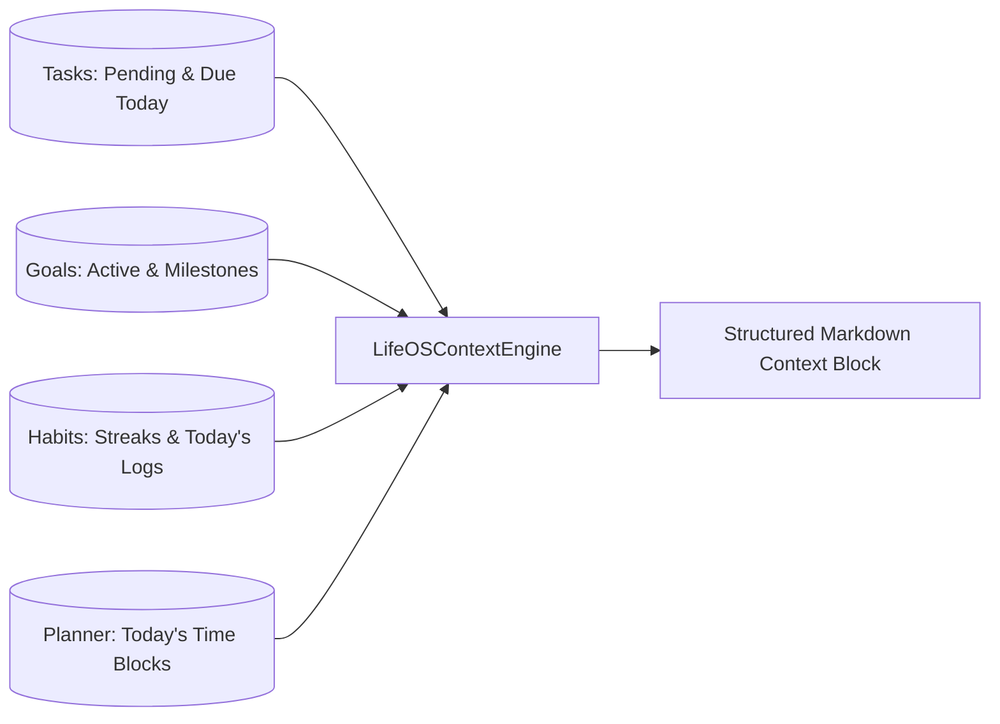

# LifeOS Context Engine

## 1. Engine Objective
The `LifeOSContextEngine` serves as the real-time bridge between the PostgreSQL database and the local LLM. It extracts the authenticated user's current operational state and builds a structured, compact markdown block suitable for prompt injection.

---

## 2. Ingested Data Streams

### Context Breakdown:
1. **Today's Schedule**:
   - Start and end times formatted in local hours (e.g. `09:00 - 10:30`).
   - Title, block type (`task`, `deep_work`, `routine`), and status (`scheduled`, `completed`).
2. **Today's Tasks**:
   - Checkbox notation `[x]` or `[ ]`.
   - Title and priority level (`high`, `medium`, `low`).
3. **Top Pending Priorities**:
   - Non-completed tasks prioritized by due date and urgency.
4. **Habits & Streaks**:
   - Habit title, today's check-in status (`Done` or `Pending`), frequency, and current streak days with flame emoji.
5. **Active Goals**:
   - Goal title, overall progress percentage, and milestone completion counts (`3/5 milestones`).

---

## 3. Context Privacy & Boundary Protection
- **No Cross-User Leaks**: Queries strictly filter by `user_id == current_user_id`.
- **Bounded Tokens**: Each section queries with a strict limit (`limit=6` for tasks, `limit=4` for goals) to prevent context overflowing the local model window.
- **Truthful Defaults**: When a collection is empty, explicit strings like `No tasks explicitly due today` are provided, preventing hallucinations.

