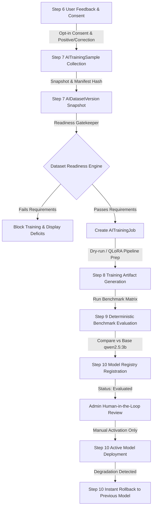

# LIFEOS — STEP 11: CONTINUOUS AI IMPROVEMENT WORKFLOW SPECIFICATION & ARCHITECTURE

## 1. Architectural Overview & Closed-Loop Lineage

Step 11 establishes an automated, auditable, and human-supervised continuous improvement lifecycle for LifeOS AI. It integrates user feedback (Step 6), consent-filtered training datasets (Step 7), QLoRA training job preparation (Step 8), deterministic benchmark evaluation (Step 9), model registry versioning (Step 10), and safe rollback telemetry into a single, coherent workflow.

---

## 2. Dataset Readiness Rules & Minimum Threshold Policy

Training jobs are prohibited from being scheduled or prepared unless the dataset version passes strict deterministic quality gates:

1. **Minimum Sample Volume**:
   - **Configured Threshold**: $\ge 5$ samples (`MIN_DATASET_SAMPLE_THRESHOLD = 5`).
   - **Engineering Rationale**: LifeOS targets task planning, habit coaching, and goal management tasks on resource-constrained local infrastructure. Requiring 5 vetted, high-quality, domain-specific samples ensures balanced task coverage without accumulating low-signal noise, while maintaining reproducibility.
2. **Consent & Privacy Compliance**:
   - Every sample must have `consent_revoked = False`. If a user revokes learning consent, the dataset version readiness drops to `False` with explicit blocking reasons.
   - Every sample must be PII-sanitized (`is_sanitized = True`).
   - Every sample must be reviewed and approved (`review_status = "approved"`).
3. **Quality & Duplicate Gates**:
   - **Quality Score**: Average quality score of samples must be $\ge 0.80$.
   - **Deduplication Check**: Normalized prompt duplicate rate must not exceed $15\%$.

---

## 3. Training Job State Machine & Concurrency Control

`AITrainingJob` implements an explicit 7-state finite state machine:

- `pending`: Job record created, awaiting resource allocation or schedule.
- `validating`: System is running data integrity verification and dry-run preparation.
- `ready`: Ready for execution or exported for remote GPU execution.
- `running`: Active training execution in progress.
- `completed`: Successfully trained or dry-run generated with verified artifact checksum.
- `failed`: Job encountered errors during preparation or execution.
- `cancelled`: Operator manually aborted the job before completion.

### Concurrency Protection
To prevent duplicate resource consumption or training race conditions, the system enforces a strict invariant: **only one active job (`pending`, `validating`, `ready`, or `running`) can exist per dataset version at any time**. Subsequent attempts to create or run jobs for that version return `HTTP 409 Conflict`.

---

## 4. Hardware Safety & Zero Development PC GPU Usage

> [!IMPORTANT]
> **Zero GPU / Zero Cloud Compute Guarantee**:
> In strict compliance with LifeOS development policies:
> - No actual GPU training or bit-quantized CUDA kernels were initiated on the development workstation (Intel UHD 620 / 12GB RAM).
> - Zero money and zero cloud GPU resources were rented.
> - Job execution executes in `dry_run=True` mode, verifying tokenization lengths, dataset export SHA-256 hashes, adapter configuration JSON manifests, and Ollama Modelfile structures without local thermal or RAM exhaustion.

---

## 5. Model Evaluation, Registry & Safe Activation Separation

- **Automated Comparison**: When a job completes, `post_training_evaluate_and_register` runs the candidate model against the Step 9 benchmark dataset (evaluating answer relevance, instruction following, response completeness, and context utilization) comparing deltas against baseline `qwen2.5:3b`.
- **Registry Integration**: Candidate models are registered in `AIModelVersion` with status `evaluated`.
- **No Automatic Promotion**: Candidate models are **never** automatically promoted to `is_active=True`.
- **Human-in-the-Loop Activation**: Only authorized human administrators using `POST /api/v1/ai/models/<id>/activate` can promote an approved candidate after testing Ollama availability.
- **Rollback Protection**: The active runtime model (`qwen2.5:3b`) remains completely untouched throughout the improvement cycle. If a newly activated model experiences degradation, admins can execute an atomic one-click rollback (`POST /api/v1/ai/models/rollback`).

---

## 6. REST API Reference

All routes are mounted at `/api/v1/ai/improvement`:

| Method | Endpoint | Access | Description |
| :--- | :--- | :--- | :--- |
| `GET` | `/dashboard` | Authenticated | Aggregates active model telemetry, feedback statistics, datasets, and jobs |
| `GET` | `/datasets/<version_name>/readiness` | Authenticated | Returns detailed readiness report, sample metrics, and blocking reasons |
| `GET` | `/jobs` | Authenticated | Lists all AI training jobs with pagination and filter support |
| `POST` | `/jobs` | Admin Only | Creates and schedules a new training job for an eligible dataset version |
| `POST` | `/jobs/<job_id>/execute` | Admin Only | Executes dry-run pipeline preparation and generates artifact checksum |
| `POST` | `/jobs/<job_id>/cancel` | Admin Only | Aborts a running or queued training job with operator reason |
| `POST` | `/jobs/<job_id>/post-train` | Admin Only | Evaluates completed job against benchmark and registers candidate model |

---

## 7. Mobile UI Experience

The mobile dashboard screen is accessible via navigation route `AIImprovementDashboard`:
- **Active Model Card**: Displays the live active inference model (`qwen2.5:3b`), benchmark score (82%), and rollback status badge.
- **Feedback & Dataset Readiness**: Shows thumbs up/down distribution, pending feedback items, and eligibility for retraining.
- **Training Job Monitor**: Displays job cards with color-coded status badges (`ready`, `validating`, `completed`, `cancelled`, `failed`), base model, and artifact SHA-256 digests.
- **Model Candidate Registry**: Visualizes candidate models awaiting review, evaluation scores, and activation status.

---

## 8. Verification & Test Suite Summary

- **Backend Continuous Improvement Suite** (`backend/tests/test_ai_improvement.py`):
  - 8/8 tests passed (readiness gates, threshold checks, consent revocation blocking, job lifecycle, concurrency prevention, cancellation, post-training evaluation, REST API endpoints).
- **Backend Full AI Regression Suite**:
  - 59/59 tests passed across Steps 7, 8, 9, 10, and 11 (`test_ai_improvement.py`, `test_ai_model_version.py`, `test_ai_evaluation.py`, `test_ai_training.py`, `test_ai_dataset.py`).
- **Mobile Test Suite**:
  - 158/158 tests passed in Jest/tsx runner.
- **Mobile TypeScript Typecheck**:
  - `npm --prefix mobile run typecheck` passed with 0 errors.
