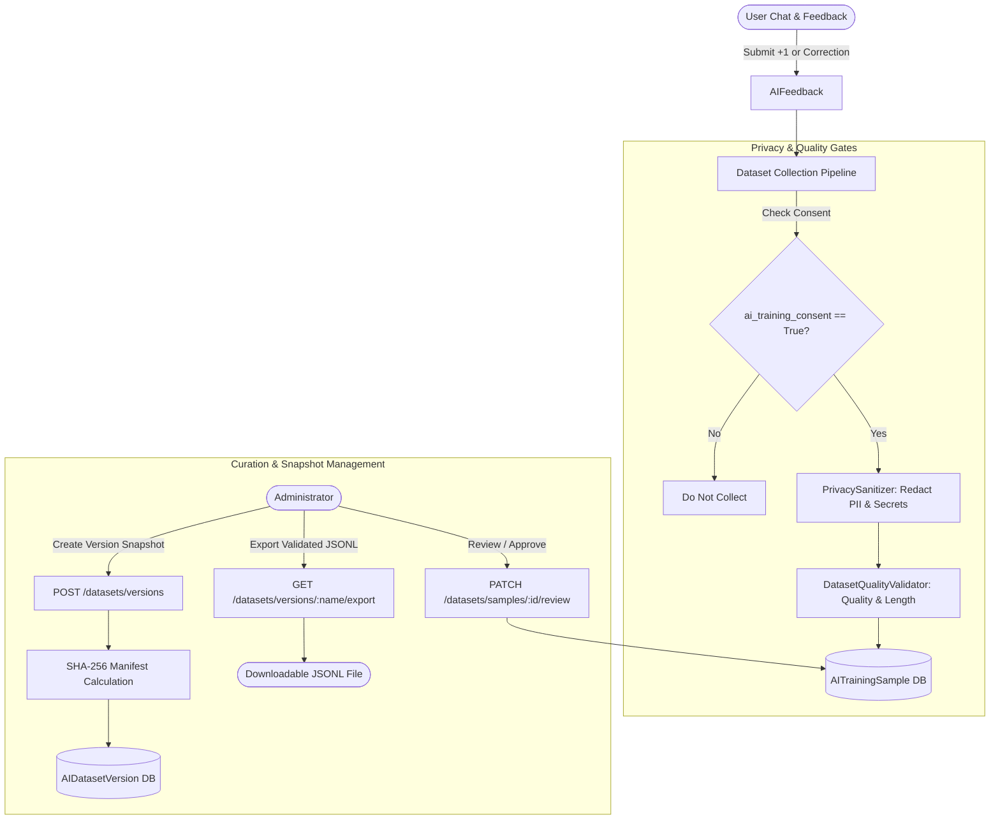

# LIFEOS — STEP 7: AI TRAINING DATASET MANAGEMENT SPECIFICATION & AUDIT

**Author**: Senior AI Architect, Python Flask Architect, React Native Engineer  
**Date**: November 9, 2026  
**Status**: Completed & Verified  

---

## 1. Executive Summary

STEP 7 implements **AI Training Dataset Management** for LifeOS. The system provides an end-to-end, secure, and structured pipeline for collecting eligible conversational turns and user feedback, sanitizing text of PII and secrets, deterministically validating instruction quality, snapshotting immutable dataset versions, and producing verifiable JSONL exports for future offline fine-tuning.

Crucially:
1. **Consent-Gated Only**: Records are strictly collected only when users have explicitly opted into `ai_training_consent`. If consent is withdrawn, candidate training records are transactionally revoked.
2. **Deterministic Privacy Sanitization**: Regex and heuristic filters strip PII (emails, phone numbers, SSNs, credit cards, IP addresses) and secrets (Bearer tokens, API keys, passwords, database URLs, private keys) before samples can be reviewed or exported.
3. **Deterministic Quality Validation**: Enforces length constraints, non-empty text, non-degenerate input/output separation, DPO pair difference, and category compliance.
4. **Immutable Version Snapshots**: Dataset versions record an authoritative SHA-256 manifest hash calculated across canonical JSON records, guaranteeing reproducibility without silent mutation.
5. **Strict Admin RBAC Protection**: Dataset management endpoints (`/api/v1/ai/datasets/*`) require administrative privileges (`admin_required`), protecting all multi-tenant conversation data from unauthorized access.
6. **No Automated Model Training**: In accordance with the prompt specification, no fine-tuning, training, or weight modification was performed.

---

## 2. Architecture & Components

### 2.1 Backend Implementation

1. **Database Schema & Models** ([`backend/app/models/ai.py`](file:///c:/Users/NexviTech/Desktop/LifePs/backend/app/models/ai.py)):
   - `AITrainingSample`: Curated instruction sample (`id`, `user_id`, `source_feedback_id`, `source_message_id`, `prompt_input`, `chosen_response`, `rejected_response`, `dataset_type`, `category`, `consent_status`, `review_status`, `sanitization_status`, `validation_status`, `validation_notes`, `dataset_version_id`, `quality_score`).
   - `AIDatasetVersion`: Immutable version snapshot (`id`, `version_name`, `description`, `sample_count`, `dataset_type`, `manifest_hash`, `included_categories`, `validation_summary`, `is_exported`, `exported_at`, `created_by`).
   - Migration: [`backend/migrations/versions/b7e3d1a89f24_add_step7_ai_dataset_management_tables.py`](file:///c:/Users/NexviTech/Desktop/LifePs/backend/migrations/versions/b7e3d1a89f24_add_step7_ai_dataset_management_tables.py).

2. **Privacy Sanitizer** ([`backend/app/ai/dataset/sanitizer.py`](file:///c:/Users/NexviTech/Desktop/LifePs/backend/app/ai/dataset/sanitizer.py)):
   - Redacts PII: emails (`[EMAIL_REDACTED]`), phone numbers (`[PHONE_REDACTED]`), SSNs (`[SSN_REDACTED]`), credit cards (`[CARD_REDACTED]`), IPv4/IPv6 addresses (`[IP_REDACTED]`).
   - Redacts Secrets: API keys, Bearer tokens (`Bearer [REDACTED_TOKEN]`), passwords, database URLs, and RSA/OpenSSH private keys.

3. **Quality Validator** ([`backend/app/ai/dataset/validator.py`](file:///c:/Users/NexviTech/Desktop/LifePs/backend/app/ai/dataset/validator.py)):
   - Verifies active consent status (`granted`).
   - Verifies sanitization status (`sanitized`).
   - Enforces length thresholds (`3 <= prompt <= 4000`, `3 <= response <= 6000`).
   - Rejects degenerate prompt/response copy-cats and identical DPO pairs.
   - Enforces valid feedback categories and source message/feedback traceability.

4. **Service & Repository** ([`backend/app/services/ai_dataset_service.py`](file:///c:/Users/NexviTech/Desktop/LifePs/backend/app/services/ai_dataset_service.py), [`backend/app/repositories/ai_dataset_repository.py`](file:///c:/Users/NexviTech/Desktop/LifePs/backend/app/repositories/ai_dataset_repository.py)):
   - Automatic non-blocking collection triggered when user submits feedback (`AIFeedbackService.submit_feedback`).
   - Deterministic SHA-256 manifest hash generation over sorted canonical JSON strings.
   - Re-checks active consent status during JSONL export to ensure revoked records are never exported.

5. **API Endpoints** ([`backend/app/blueprints/ai_dataset/routes.py`](file:///c:/Users/NexviTech/Desktop/LifePs/backend/app/blueprints/ai_dataset/routes.py)):
   - `GET /api/v1/ai/datasets/samples`: List/filter training samples (Admin only).
   - `PATCH /api/v1/ai/datasets/samples/<id>/review`: Approve/reject candidate samples (Admin only).
   - `DELETE /api/v1/ai/datasets/samples/<id>`: Purge sample (Admin only).
   - `GET /api/v1/ai/datasets/statistics`: Aggregate sample metrics (Admin only).
   - `POST /api/v1/ai/datasets/versions`: Create immutable version snapshot (Admin only).
   - `GET /api/v1/ai/datasets/versions`: List dataset versions (Admin only).
   - `GET /api/v1/ai/datasets/versions/<name>`: Get version details (Admin only).
   - `GET /api/v1/ai/datasets/versions/<name>/export`: Download validated JSONL file (Admin only).

### 2.2 Mobile Considerations
- Dataset management and curation are administrative infrastructure features. In accordance with Section 11 of the specification ("Do not expose dataset management controls to ordinary users; keep mobile changes lightweight"), dataset administration controls were kept off the end-user mobile client.
- Mobile client remains lightweight, fully typechecked (`npm --prefix mobile run typecheck` passed with 0 errors), and all 158 mobile unit tests pass.

---

## 3. Verification & Test Results

### 3.1 Backend Test Coverage
1. **Dataset Suite** ([`backend/tests/test_ai_dataset.py`](file:///c:/Users/NexviTech/Desktop/LifePs/backend/tests/test_ai_dataset.py)):
   - `test_privacy_sanitizer_redaction`: Verified redaction of emails, phones, tokens, passwords, and private keys.
   - `test_quality_validator_rules`: Verified validation heuristics for length, duplicate copy-cat, consent, and categories.
   - `test_pipeline_collects_from_consented_feedback`: Verified that submitting feedback with consent active creates a valid sanitized training sample.
   - `test_pipeline_does_not_collect_without_consent`: Verified that feedback is ignored if user has not granted consent.
   - `test_admin_rbac_protection_on_dataset_endpoints`: Verified non-admin users receive HTTP 403 Forbidden on all dataset management endpoints.
   - `test_create_dataset_version_and_jsonl_export`: Verified creating an immutable snapshot version and exporting as valid JSONL.
   - **Result**: `6 passed in 2.07s`.

2. **Combined Dataset + Feedback Regression**:
   - `pytest -q backend/tests/test_ai_dataset.py backend/tests/test_ai_feedback.py backend/tests/test_ai_feedback_intelligence.py`
   - **Result**: `30 passed in 29.16s`.

3. **Full Backend Test Suite**:
   - `python -m pytest -q backend/tests`
   - **Result**: `241 passed, 19 warnings in 347.61s (0:05:47)`.

### 3.2 Mobile Unit Test & Typecheck
- **TypeScript Compilation**: `npm --prefix mobile run typecheck` passed with 0 errors.
- **Node Test Runner**: `npm --prefix mobile test` passed with `158 passed in 2.45s`.

---

## 4. Verification Checklist

| Requirement | Status | Evidence |
|---|---|---|
| **Consent-gated collection** | **VERIFIED** | `AIDatasetService.collect_from_feedback` checks `UserPreference.ai_training_consent`. Tested in `test_pipeline_collects_from_consented_feedback` and `test_pipeline_does_not_collect_without_consent`. |
| **Consent revocation handling** | **VERIFIED** | Revoking consent sets sample `consent_status = 'revoked'`. JSONL export filter strictly excludes revoked records. Tested in `test_ai_feedback.py::test_training_consent_revocation_invalidates_samples`. |
| **PII & secret sanitization** | **VERIFIED** | `PrivacySanitizer.sanitize_text` strips emails, phones, tokens, credentials, and keys before saving samples. Tested in `test_privacy_sanitizer_redaction`. |
| **Deterministic quality validation** | **VERIFIED** | `DatasetQualityValidator.validate_sample` checks lengths, empty text, degenerate copies, and categories. Tested in `test_quality_validator_rules`. |
| **Immutable version snapshots** | **VERIFIED** | `AIDatasetVersion` computes deterministic SHA-256 manifest hash over normalized JSON records. Snapshots cannot be silently overwritten. Tested in `test_create_dataset_version_and_jsonl_export`. |
| **Validated JSONL export** | **VERIFIED** | `GET /datasets/versions/<name>/export` streams validated JSONL with `X-Manifest-SHA256` and `X-Sample-Count` response headers. |
| **Admin RBAC security** | **VERIFIED** | `@admin_required()` protects all dataset routes. Non-admin users receive 403 Forbidden. Tested in `test_admin_rbac_protection_on_dataset_endpoints`. |
| **Regression tests** | **VERIFIED** | Backend: **241 passed, 0 failed** in 347s. Mobile: **158 passed, 0 failed** in 2.4s. Mobile typecheck: **0 TypeScript errors**. |
