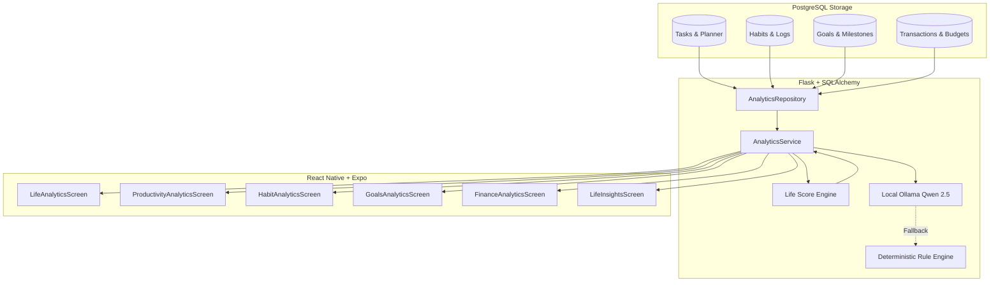

# LifeOS Life Analytics Architecture

## 1. System Overview

The **Life Analytics & Personal Insights** module (Step 16) serves as the centralized intelligence and progress engine of LifeOS. It aggregates real historical activity across four core pillars:
1. **Productivity & Planning**: Tasks created, completed, overdue, and calendar focus blocks.
2. **Habits & Routines**: Recurring daily, weekday, and weekly habits, logs, consistency rates, and streaks.
3. **Goals & Milestones**: High-level OKRs, milestone completion velocities, and upcoming target dates.
4. **Financial Discipline**: Income, expense cash flow, category breakdowns, savings rates, and budget adherence.

---

## 2. Architectural Design Principles

1. **Zero Schema Migrations**: All analytical dimensions leverage existing indexed timestamps (`created_at`, `completed_at`, `start_time`, `log_date`, `transaction_date`) and foreign keys. Aggregations use native SQL grouping, preventing data staleness and redundant caching tables.
2. **Dynamic Weight Re-Normalization**: New users or users utilizing a subset of modules are never penalized. Pillars lacking user activity are assigned zero weight, and active weights are dynamically re-normalized to sum to 100%.
3. **Privacy & Zero Cloud Telemetry**: Narrative insights are generated exclusively on-device via local Ollama `qwen2.5:3b`. If Ollama is offline or slow, a deterministic rule-based fallback executes instantly without failing the HTTP response.
4. **Timezone Awareness**: All query date intervals (`day`, `week`, `month`, `year`, `custom`) are resolved using the user's localized timezone preference via Python `zoneinfo.ZoneInfo`, then translated into exact UTC intervals for PostgreSQL timestamp indexing.
5. **IDOR & Strict User Isolation**: All SQL queries explicitly filter by `user_id == current_user_id`, preventing cross-tenant data leaks.

