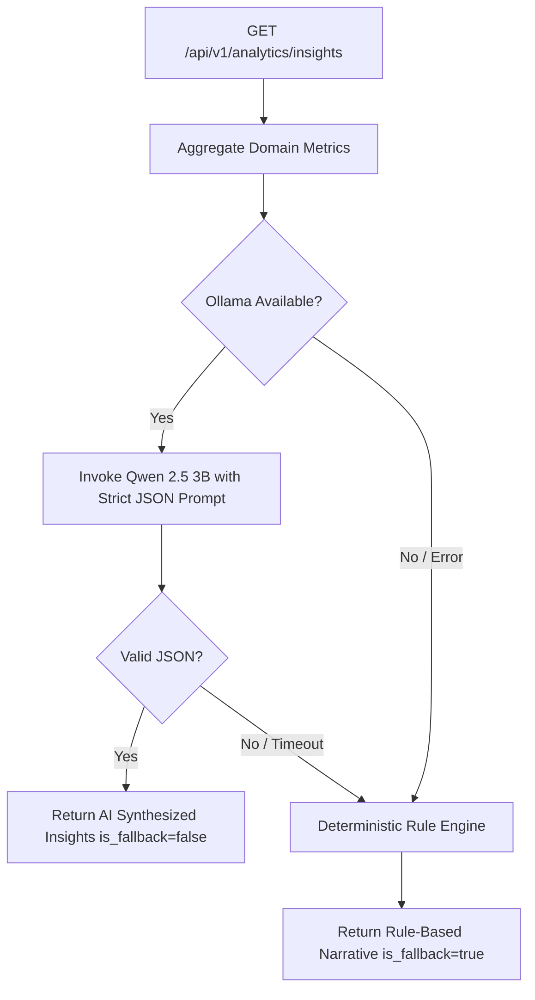

# LifeOS AI Personal Insights & Local LLM Synthesis

## 1. Local-First AI Architecture

LifeOS personal insights are powered exclusively by the local-first AI stack:
- **LLM Runner**: Local Ollama instance running on `localhost:11434`.
- **Model**: `qwen2.5:3b`.
- **Zero Cloud API Calls**: No OpenAI, Anthropic, or external cloud API calls are made.
- **Zero Telemetry Leakage**: Private tasks, financial balances, and habit histories remain strictly local.

---

## 2. Synthesis Prompt Pipeline

The analytics service constructs a structured, factual context prompt containing only verified analytical aggregations (no prompt injection vectors or raw unsanitized user strings):

```text
You are LifeOS Analytics Engine. Analyze the user's verified metrics for the {period}:
- Life Score: {life_score}/100 ({tier})
- Productivity: {completed_tasks} tasks completed ({completion_percentage}%)
- Habits: {consistency_percentage}% consistency across {active_habits} habits
- Financials: ${net_savings} net savings ({savings_rate}% savings rate)

Return a strict JSON object with these exact keys:
- executive_summary: 1-2 sentence overall summary
- productivity_observation: 1 factual sentence on work patterns
- habit_observation: 1 factual sentence on consistency
- financial_observation: 1 factual sentence on spending & savings
- actionable_recommendations: list of 3 concise actionable tips
Do NOT invent unverified data.
```

---

## 3. Deterministic Rule-Based Fallback

To guarantee high availability and prevent HTTP request failures when Ollama is offline or under load:



The fallback engine dynamically maps calculated rates (completion %, consistency %, savings rate) into clear, actionable advice, ensuring client apps always receive a 200 OK response with structured insights.

