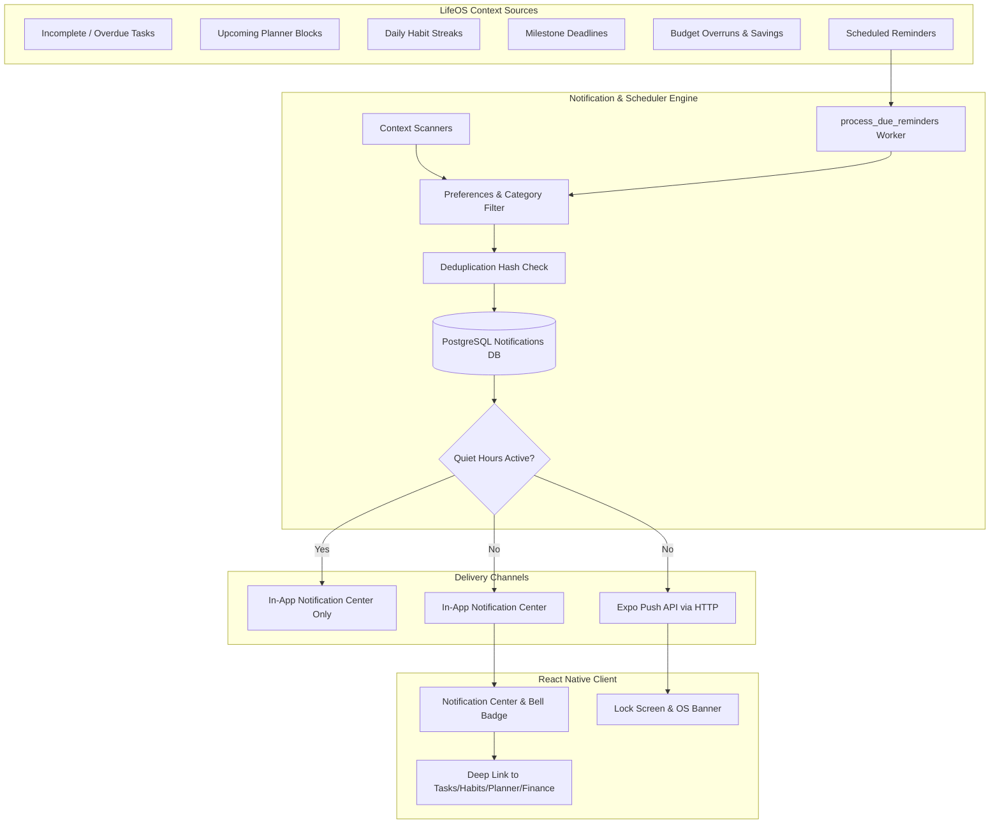

# LifeOS Centralized Notifications & Reminders Architecture

## 1. System Overview

STEP 15 implements a unified notification and reminder system across LifeOS. The engine coordinates in-app notifications, user preferences, quiet hours (Do Not Disturb), scheduled reminders, contextual triggers (tasks, habits, planner, finance), and optional Expo push notifications.

## 2. Core Architectural Principles

1. **Deterministic Application-Derived Data**: Notifications are generated exclusively from verified database records (e.g., due dates on real tasks, unlogged active habits, budget thresholds). No fabricated or hallucinated alerts.
2. **24-Hour Deduplication Suppression**: Notifications compute a SHA-256 `dedup_hash` based on `user_id` and the unique trigger event (e.g. `task_overdue:{task_id}:{date}`). If a matching notification already exists within 24 hours, duplicate creation is suppressed.
3. **Respect for Quiet Hours & Timezones**: Users configure custom sleep windows (e.g. `22:00` to `08:00`). Using the user's localized timezone, the service evaluates whether the current time falls inside quiet hours (supporting overnight intervals). During quiet hours, intrusive push notifications are suppressed and recorded as `skipped_quiet_hours` in the delivery audit log, while in-app notifications are saved silently.
4. **Resilient Reminder Scheduler**: Reminders use PostgreSQL row-level locks (`SELECT ... FOR UPDATE SKIP LOCKED`) so concurrent background ticks or worker restarts never process the same reminder twice. Recurring reminders automatically compute and schedule the next occurrence (`daily`, `weekdays`, `weekly`, `monthly`).
5. **Strict IDOR & Multi-Tenant Security**: Every notification, reminder, preference, and push token is user-scoped (`user_id == current_user`). Cross-user access returns HTTP 404 or 403.

