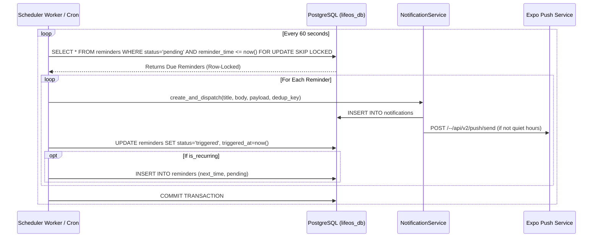

# LifeOS Reminder Scheduler & Background Engine

## 1. Design & Deployment Model

The LifeOS reminder scheduler is designed to be deployment-agnostic, restart-safe, and crash-resilient without depending on an in-memory timer or a long-lived web request.



## 2. Idempotency & Concurrency Guarantees

1. **Row-Level Locking (`SKIP LOCKED`)**:
   Query:
   ```sql
   SELECT * FROM reminders
   WHERE status = 'pending' AND reminder_time <= NOW()
   ORDER BY reminder_time ASC
   LIMIT 100
   FOR UPDATE SKIP LOCKED;
   ```
   If multiple worker instances execute concurrently (e.g. horizontally scaled Flask workers or multiple container replicas), each worker exclusively locks distinct rows. Zero duplicate triggers occur.

2. **Deduplication Hash**:
   Each reminder creates a notification with `dedup_hash = sha256(f"{user_id}:reminder:{reminder_id}:{reminder_time}")`. Even if a network retry occurs, duplicate notifications are prevented at the database constraint level.

3. **Recurrence Computation**:
   - `daily`: `reminder_time + INTERVAL '1 day'`
   - `weekdays`: skips Saturday (weekday 5) and Sunday (weekday 6) to the next Monday
   - `weekly`: `reminder_time + INTERVAL '7 days'`
   - `monthly`: `reminder_time + INTERVAL '30 days'`

## 3. Production Deployment Options

### Option A: System Cron / Cloud Scheduler (Recommended for serverless/containers)
Add a cron job hitting the internal management endpoint every 1 minute:
```bash
* * * * * curl -s -X POST http://localhost:5000/api/v1/notifications/process-due > /dev/null
```

### Option B: Standalone Python Background Worker
Run a lightweight background worker script in a systemd service or Docker worker container:
```python
# scripts/reminder_worker.py
import time
from app import create_app
from app.services.notification_service import NotificationService

app = create_app()
service = NotificationService()

with app.app_context():
    while True:
        try:
            processed = service.process_due_reminders()
            if processed > 0:
                print(f"Processed {processed} due reminders.")
        except Exception as e:
            print(f"Error in scheduler worker: {e}")
        time.sleep(60)
```

