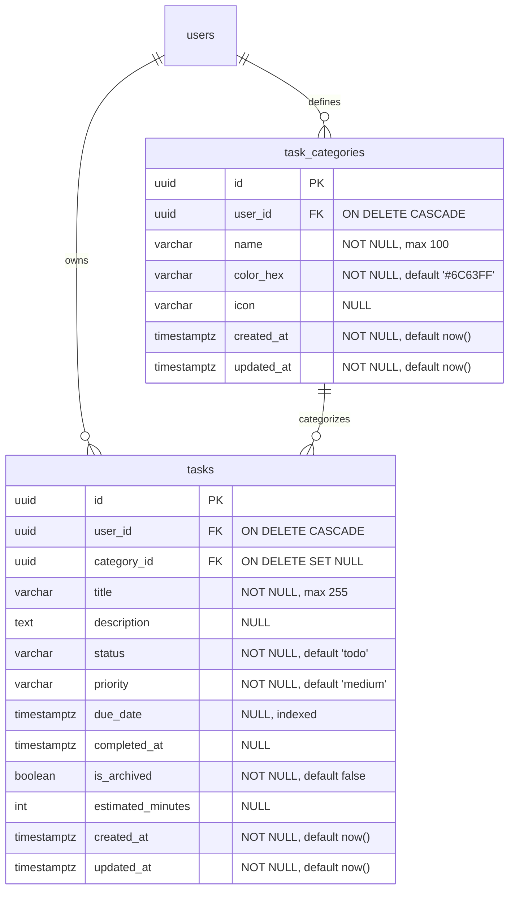

# LifeOS Task Database Design

## 1. Schema & Relational Structure

The Task Management module uses PostgreSQL 3NF normalized tables defined in STEP 02:

---

## 2. Indexes & Performance Optimization

| Table | Index Name | Columns | Pattern / Purpose |
| :--- | :--- | :--- | :--- |
| `tasks` | `ix_tasks_user_status` | `(user_id, status)` | Fast dashboard & list status filtering |
| `tasks` | `ix_tasks_user_due_date` | `(user_id, due_date)` | Daily overview & "today" filtering queries |
| `tasks` | `ix_tasks_user_priority` | `(user_id, priority)` | Priority matrix sorting |
| `tasks` | `ix_tasks_user_archived` | `(user_id, is_archived)` | Active task segregation |
| `task_categories` | `uq_task_category_user_name` | `(user_id, name)` UNIQUE | Prevents duplicate category names per user |

---

## 3. Foreign Key Deletion Semantics

- **User Deletion**: `ON DELETE CASCADE`. If a user account is deleted, all their tasks and categories are purged automatically.
- **Category Deletion**: `ON DELETE SET NULL`. If a category is deleted, associated tasks retain their data and have their `category_id` set to `NULL`.

