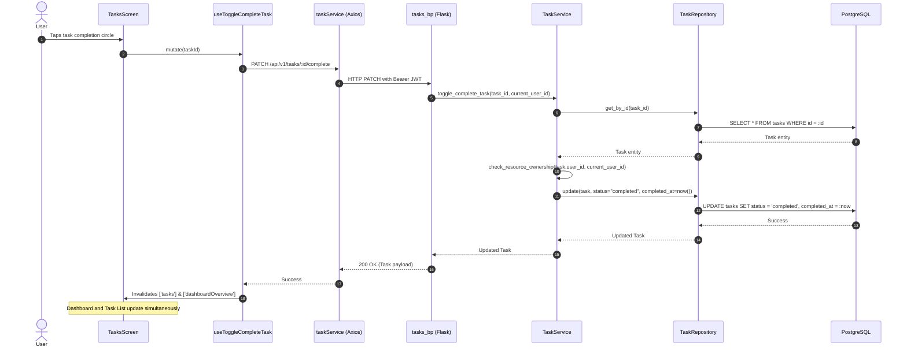

# LifeOS Task Management Architecture

## 1. Executive Summary & Design Principles

The **Smart Task Management System** is a foundational execution domain of LifeOS. It manages the complete lifecycle of daily to-dos, priorities, deadlines, and project milestones across both the Flask REST API and the React Native client.

### Key Architectural Tenets
- **Strict User Isolation**: All task queries enforce `user_id == current_user_id` derived exclusively from cryptographically verified JWT tokens. Cross-user IDOR access is strictly rejected with HTTP 403.
- **Layered Backend Architecture**: Clear separation between API Blueprints (`routes.py`), Validation (`schemas/task.py`), Business Logic (`services/task_service.py`), and Data Access (`repositories/task_repository.py`).
- **N+1 Prevention**: Category relationships are eager-loaded with SQLAlchemy `joinedload(Task.category)`.
- **Reactive Cache Synchronization**: TanStack Query mutations (`useCreateTask`, `useUpdateTask`, `useToggleCompleteTask`, `useDeleteTask`) invalidate both task queries (`['tasks']`) and dashboard queries (`['dashboardOverview']`), ensuring real-time UI synchronization without page reloads.

---

## 2. Component Hierarchy & Navigation

```
MainTabNavigator (Bottom Tab Bar)
└── TasksTab (TasksScreen)
    ├── Screen Header ("Tasks", total task count badge, "+ New Task" button)
    ├── SearchInput (debounced query filter)
    ├── Status Filter Chips (All, Pending, In Progress, Completed)
    ├── Priority Filter Chips (All, Urgent, High, Medium, Low)
    ├── Task List (FlatList / ScrollContainer)
    │   ├── SkeletonLoader (during fetch)
    │   ├── ErrorState (with retry on failure)
    │   ├── EmptyState (when zero tasks match active filters)
    │   └── Task Item Cards
    │       ├── Color-coded Priority Strip (urgent, high, medium, low)
    │       ├── Interactive Checkbox (1-tap complete / uncomplete toggle)
    │       ├── Title & Category Tag Chip
    │       └── Due Date indicator
    ├── CreateEditTaskModal
    │   ├── Title (validated required input)
    │   ├── Description (multiline glass input)
    │   ├── Priority selector chips (Low, Medium, High, Urgent)
    │   ├── Category selector chips (loaded from useTaskCategories)
    │   └── Due Date quick buttons (Today, Tomorrow, Next Week, Clear)
    └── TaskDetailsModal
        ├── Title, Priority badge, Category chip, Status badge
        ├── Description scroll view
        ├── Date metadata (Due date, Completed at, Created at)
        ├── "Mark Completed" / "Reopen" PrimaryButton
        ├── "Edit Task" SecondaryButton
        └── "Delete" Action (with ConfirmationModal)
```

---

## 3. End-to-End Sequence Diagram



