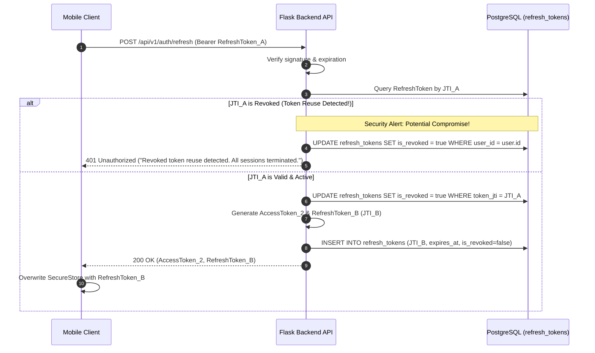

# LifeOS – Token Lifecycle & Rotation (RTR)

## 1. Token Specifications
| Property | Access Token | Refresh Token |
| :--- | :--- | :--- |
| **Duration** | 1 Hour (3600s) | 30 Days (2,592,000s) |
| **Storage (Mobile)** | Memory / Fast State | Expo `SecureStore` (Keychain / Keystore) |
| **Storage (Backend)** | Stateless JWT verification | Stateful `refresh_tokens` table with cryptographic `JTI` |
| **Scope** | Authorizes API requests (`/api/v1/*`) | Rotates tokens (`/api/v1/auth/refresh`) & terminates sessions |

---

## 2. Refresh Token Rotation (RTR) Flow

---

## 3. Token Invalidation on Logout
1. Client calls `POST /api/v1/auth/logout` supplying the current refresh token in the `Authorization: Bearer <refresh_token>` header.
2. The endpoint extracts the token claim `jti` and sets `is_revoked = True` in PostgreSQL.
3. Once marked revoked, any subsequent refresh attempt presenting this token is immediately rejected.
4. Short-lived access tokens expire naturally within their 1-hour window without requiring stateful database queries on every HTTP request.

